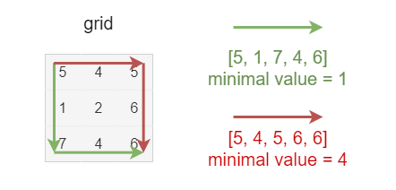
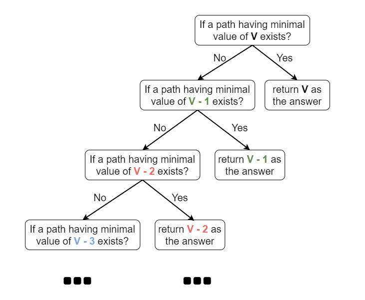
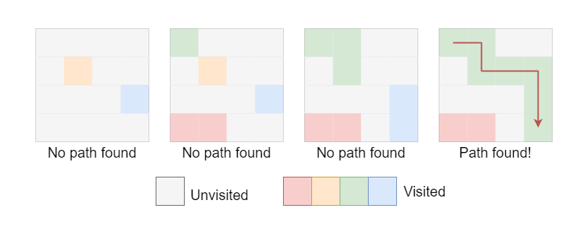

# 1102. Path With Maximum Minimum Value — Complete Guide

## Problem Overview

Given a **2D integer matrix**, find a path from the **top-left cell `(0,0)`** to the **bottom-right cell `(m-1, n-1)`**, moving only in the four cardinal directions (up, down, left, right).

The **score of a path** is the **minimum cell value** encountered along that path. Your goal is to **maximize this score** — in other words, find the path whose weakest link is as strong as possible.



### Illustrative Example

```
Green Path: [5, 1, 7, 4, 6]  →  Score = min(5,1,7,4,6) = 1
Red Path:   [5, 4, 5, 6, 6]  →  Score = min(5,4,5,6,6) = 4
```

The **red path wins** because even its lowest value (4) is higher than the green path's lowest value (1). We want to avoid paths that dip through low-valued cells.

---

## Approach 1: Iterative Score Check + BFS (Brute Force)

### Core Idea

Instead of searching over all paths directly, reframe the problem as a **yes/no question**:

> "Does a valid path exist where every cell value is at least `S`?"

If we can answer this efficiently, we can try decreasing values of `S` until we find the largest one that still permits a valid path.

### Key Optimization

We never need to try a score higher than `min(grid[0][0], grid[m-1][n-1])` — any valid path must pass through both corners, so the score is capped by whichever corner is smaller.



### How It Works

Start `curScore = min(grid[0][0], grid[m-1][n-1])` and run a BFS that only steps onto cells with value ≥ `curScore`. If BFS reaches the destination, return `curScore`. Otherwise decrement and retry.


### Algorithm Steps

1. Set `curScore = min(grid[0][0], grid[R-1][C-1])`.
2. Run BFS from `(0,0)`, only visiting cells where `grid[row][col] >= curScore`.
3. If `(R-1, C-1)` is reachable → return `curScore`.
4. Decrement `curScore` and repeat.

```java
import java.util.*;

class Solution {
    public int maximumMinimumPath(int[][] grid) {
        int R = grid.length;
        int C = grid[0].length;

        // Cap the starting score at the smaller of the two corners
        int curScore = Math.min(grid[0][0], grid[R - 1][C - 1]);

        int[][] dirs = {{0, 1}, {0, -1}, {1, 0}, {-1, 0}};

        while (curScore >= 0) {
            if (bfs(grid, curScore, R, C, dirs)) {
                return curScore;
            }
            curScore--;
        }

        return -1; // Should never reach here for valid inputs
    }

    private boolean bfs(int[][] grid, int score, int R, int C, int[][] dirs) {
        if (grid[0][0] < score || grid[R - 1][C - 1] < score) return false;

        boolean[][] visited = new boolean[R][C];
        Queue<int[]> queue = new LinkedList<>();

        queue.offer(new int[]{0, 0});
        visited[0][0] = true;

        while (!queue.isEmpty()) {
            int[] curr = queue.poll();
            int row = curr[0], col = curr[1];

            if (row == R - 1 && col == C - 1) return true;

            for (int[] dir : dirs) {
                int newRow = row + dir[0];
                int newCol = col + dir[1];

                if (newRow >= 0 && newRow < R
                        && newCol >= 0 && newCol < C
                        && !visited[newRow][newCol]
                        && grid[newRow][newCol] >= score) {
                    visited[newRow][newCol] = true;
                    queue.offer(new int[]{newRow, newCol});
                }
            }
        }

        return false;
    }
}
```

### Complexity

|           |                                                                  |
| --------- | ---------------------------------------------------------------- |
| **Time**  | `O(n × m × k)` — BFS runs up to `k` times, each costing `O(n×m)` |
| **Space** | `O(n × m)` — visited array per BFS run                           |

Where `k` = maximum cell value in the grid.

---

## Approach 2: Binary Search + BFS

### Core Idea

Notice a key **monotonic property** in the feasibility of a score `S`:

- If a valid path exists for score `S`, it also exists for any score `< S` (we can always travel through lower-valued cells).
- If no valid path exists for score `S`, none can exist for any score `> S`.

This monotonicity means we can **binary search** on the answer instead of stepping down one by one — cutting the number of BFS calls from `k` to `log(k)`.

### Algorithm Steps

1. Set `left = 0`, `right = min(grid[0][0], grid[m-1][n-1])`.
2. Compute `mid = (left + right + 1) / 2` (upper-mid to avoid infinite loop).
3. Run BFS to check if a path with all values ≥ `mid` exists.
4. If yes → `left = mid` (try higher).
5. If no → `right = mid - 1` (try lower).
6. Repeat until `left == right`. Return `left`.

```java
import java.util.*;

class Solution {
    public int maximumMinimumPath(int[][] grid) {
        int R = grid.length, C = grid[0].length;
        int[][] dirs = {{0,1},{0,-1},{1,0},{-1,0}};

        int left = 0, right = Math.min(grid[0][0], grid[R-1][C-1]);

        while (left < right) {
            int mid = (left + right + 1) / 2;
            if (canReach(grid, mid, R, C, dirs)) {
                left = mid;
            } else {
                right = mid - 1;
            }
        }
        return left;
    }

    private boolean canReach(int[][] grid, int score, int R, int C, int[][] dirs) {
        boolean[][] visited = new boolean[R][C];
        Queue<int[]> queue = new LinkedList<>();
        queue.offer(new int[]{0, 0});
        visited[0][0] = true;

        while (!queue.isEmpty()) {
            int[] curr = queue.poll();
            int row = curr[0], col = curr[1];

            if (row == R - 1 && col == C - 1) return true;

            for (int[] dir : dirs) {
                int nr = row + dir[0], nc = col + dir[1];
                if (nr >= 0 && nr < R && nc >= 0 && nc < C
                        && !visited[nr][nc] && grid[nr][nc] >= score) {
                    visited[nr][nc] = true;
                    queue.offer(new int[]{nr, nc});
                }
            }
        }
        return false;
    }
}
```

### Complexity

|           |                                                                            |
| --------- | -------------------------------------------------------------------------- |
| **Time**  | `O(n × m × log(k))` — binary search reduces BFS calls from `k` to `log(k)` |
| **Space** | `O(n × m)` — visited array                                                 |

---

## Approach 3: Binary Search + DFS

### Core Idea

Identical in structure to Approach 2, but the **path feasibility check uses DFS** (recursive or stack-based) instead of BFS. Both explore all reachable cells; DFS tends to use less memory in practice on sparse traversals because it doesn't hold an entire frontier queue.

### Algorithm Steps

1. Binary search on the score range `[0, min(grid[0][0], grid[m-1][n-1])]`.
2. For each `mid`, use **DFS** from `(0,0)` to see if `(m-1,n-1)` is reachable through cells ≥ `mid`.
3. Adjust binary search bounds exactly as in Approach 2.

```java
import java.util.*;

class Solution {
    int R, C;
    int[][] dirs = {{0,1},{0,-1},{1,0},{-1,0}};

    public int maximumMinimumPath(int[][] grid) {
        R = grid.length; C = grid[0].length;
        int left = 0, right = Math.min(grid[0][0], grid[R-1][C-1]);

        while (left < right) {
            int mid = (left + right + 1) / 2;
            boolean[][] visited = new boolean[R][C];
            if (dfs(grid, 0, 0, mid, visited)) {
                left = mid;
            } else {
                right = mid - 1;
            }
        }
        return left;
    }

    private boolean dfs(int[][] grid, int row, int col, int score, boolean[][] visited) {
        if (row == R - 1 && col == C - 1) return true;
        visited[row][col] = true;

        for (int[] dir : dirs) {
            int nr = row + dir[0], nc = col + dir[1];
            if (nr >= 0 && nr < R && nc >= 0 && nc < C
                    && !visited[nr][nc] && grid[nr][nc] >= score) {
                if (dfs(grid, nr, nc, score, visited)) return true;
            }
        }
        return false;
    }
}
```

### Complexity

|           |                                                                        |
| --------- | ---------------------------------------------------------------------- |
| **Time**  | `O(n × m × log(k))` — same as Approach 2                               |
| **Space** | `O(n × m)` — recursion stack can be up to `n×m` deep in the worst case |

---

## Approach 4: Greedy BFS with Max-Heap (Modified Dijkstra)

### Core Idea

Rather than guessing a score and verifying, we can **greedily build the best path** from scratch. The insight: at every step, always expand the neighboring cell with the **highest value** — this maximally delays encountering low-valued cells and gives the globally best minimum.

This is analogous to **Dijkstra's shortest path algorithm**, but instead of minimizing accumulated cost we are **maximizing the minimum value seen so far**. A max-heap (priority queue) drives the greedy expansion.

### How It Works

Each entry in the heap is `(cellValue, row, col)`. We always pop the largest unvisited cell. As we expand outward, we track `ans = min(ans, currentCellValue)`. The moment we pop the destination cell, `ans` holds our answer — because we always took the "best available" step, no other path could achieve a higher minimum.

### Algorithm Steps

1. Initialize `ans = grid[0][0]`, push `(grid[0][0], 0, 0)` onto a max-heap.
2. Mark `(0,0)` visited.
3. While heap is not empty:
   - Pop the cell with the largest value.
   - Update `ans = min(ans, cell value)`.
   - If this is `(m-1, n-1)`, return `ans`.
   - Push all unvisited valid neighbors.

```java
import java.util.*;

class Solution {
    public int maximumMinimumPath(int[][] grid) {
        int R = grid.length, C = grid[0].length;
        int[][] dirs = {{0,1},{0,-1},{1,0},{-1,0}};

        // Max-heap: [value, row, col]
        PriorityQueue<int[]> maxHeap = new PriorityQueue<>((a, b) -> b[0] - a[0]);
        boolean[][] visited = new boolean[R][C];

        maxHeap.offer(new int[]{grid[0][0], 0, 0});
        visited[0][0] = true;
        int ans = grid[0][0];

        while (!maxHeap.isEmpty()) {
            int[] curr = maxHeap.poll();
            int val = curr[0], row = curr[1], col = curr[2];

            // The minimum along the best path so far
            ans = Math.min(ans, val);

            if (row == R - 1 && col == C - 1) return ans;

            for (int[] dir : dirs) {
                int nr = row + dir[0], nc = col + dir[1];
                if (nr >= 0 && nr < R && nc >= 0 && nc < C && !visited[nr][nc]) {
                    visited[nr][nc] = true;
                    maxHeap.offer(new int[]{grid[nr][nc], nr, nc});
                }
            }
        }

        return ans;
    }
}
```

### Complexity

|           |                                                                                 |
| --------- | ------------------------------------------------------------------------------- |
| **Time**  | `O(n × m × log(n × m))` — each cell is pushed/popped from the heap at most once |
| **Space** | `O(n × m)` — heap and visited array                                             |

> **Why this is often the preferred approach:** No binary search overhead, no repeated BFS passes — a single traversal finds the answer directly.

---

## Approach 5: Union-Find (Offline / Sort-Based)

### Core Idea

Imagine you have a dial that **activates cells from highest value to lowest**, one by one. As each cell is activated, it is connected to any already-active neighbors using **Union-Find** (Disjoint Set Union). We monitor connectivity: the moment the top-left cell `(0,0)` and the bottom-right cell `(m-1,n-1)` become part of the same component, the **currently activated cell's value** is our answer — it's the lowest value we were forced to include to create a valid path.



Because we activate in descending order, we never "undo" a connection. This is an elegant offline algorithm that avoids any traversal loop entirely.

### Algorithm Steps

1. Collect all cells as `(value, row, col)` triples and **sort descending by value**.
2. Initialize a Union-Find structure over all `n×m` cells.
3. For each cell in sorted order:
   - Mark it as active.
   - Union it with any already-active neighbors (up/down/left/right).
   - Check: are `(0,0)` and `(m-1,n-1)` in the same component?
   - If yes → return the current cell's value.

```java
import java.util.*;

class Solution {
    int[] parent, rank;

    public int maximumMinimumPath(int[][] grid) {
        int R = grid.length, C = grid[0].length;
        int[][] dirs = {{0,1},{0,-1},{1,0},{-1,0}};

        // Collect and sort all cells descending by value
        List<int[]> cells = new ArrayList<>();
        for (int r = 0; r < R; r++)
            for (int c = 0; c < C; c++)
                cells.add(new int[]{grid[r][c], r, c});
        cells.sort((a, b) -> b[0] - a[0]);

        parent = new int[R * C];
        rank   = new int[R * C];
        for (int i = 0; i < R * C; i++) parent[i] = i;

        boolean[][] visited = new boolean[R][C];

        for (int[] cell : cells) {
            int val = cell[0], row = cell[1], col = cell[2];
            visited[row][col] = true;

            for (int[] dir : dirs) {
                int nr = row + dir[0], nc = col + dir[1];
                if (nr >= 0 && nr < R && nc >= 0 && nc < C && visited[nr][nc]) {
                    union(row * C + col, nr * C + nc);
                }
            }

            // Check if start and end are now connected
            if (find(0) == find((R - 1) * C + (C - 1))) return val;
        }

        return -1;
    }

    private int find(int x) {
        if (parent[x] != x) parent[x] = find(parent[x]); // Path compression
        return parent[x];
    }

    private void union(int x, int y) {
        int px = find(x), py = find(y);
        if (px == py) return;
        if (rank[px] < rank[py]) { int tmp = px; px = py; py = tmp; }
        parent[py] = px;
        if (rank[px] == rank[py]) rank[px]++;
    }
}
```

### Complexity

|           |                                                                                                               |
| --------- | ------------------------------------------------------------------------------------------------------------- |
| **Time**  | `O(n × m × log(n × m))` — dominated by sorting; Union-Find operations are near-constant with path compression |
| **Space** | `O(n × m)` — Union-Find arrays, visited array, sorted cell list                                               |

---

## Approaches at a Glance

| Approach                | Algorithm           | Time              | Space    | Notes                                       |
| ----------------------- | ------------------- | ----------------- | -------- | ------------------------------------------- |
| 1 — Brute Force         | Linear scan + BFS   | `O(n·m·k)`        | `O(n·m)` | Simple but slow for large values            |
| 2 — Binary Search + BFS | Binary search + BFS | `O(n·m·log k)`    | `O(n·m)` | Big improvement over Approach 1             |
| 3 — Binary Search + DFS | Binary search + DFS | `O(n·m·log k)`    | `O(n·m)` | Same as #2, DFS may suit recursion fans     |
| 4 — Greedy Max-Heap     | Modified Dijkstra   | `O(n·m·log(n·m))` | `O(n·m)` | Single-pass, clean and practical            |
| 5 — Union-Find          | Sort + DSU          | `O(n·m·log(n·m))` | `O(n·m)` | Elegant offline approach, no traversal loop |

> **Recommended:** Approach 4 (Greedy Max-Heap) for interviews — it's intuitive, single-pass, and directly maps to a well-known algorithm pattern. Approach 5 (Union-Find) is the most elegant if you're comfortable with DSU.
