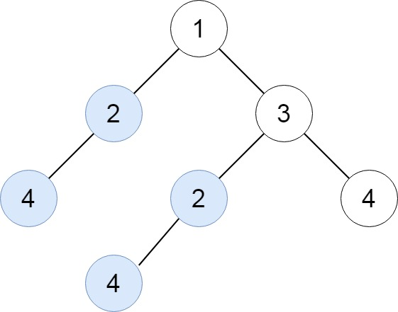
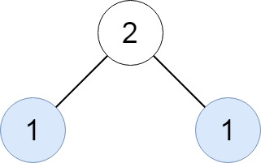
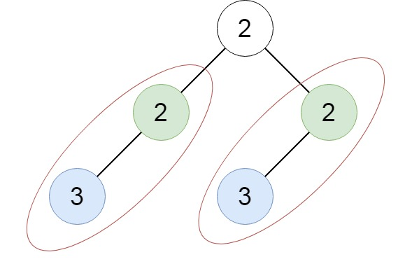

# 652. Find Duplicate Subtrees

Given the `root` of a binary tree, return all duplicate subtrees.
For each kind of duplicate subtrees, you only need to return the root node of any one of them.
Two trees are **duplicate** if they have the same structure with the same node values.

---

## Examples

### Example 1



```
Input: root = [1,2,3,4,null,2,4,null,null,4]
Output: [[2,4],[4]]
```

### Example 2



```
Input: root = [2,1,1]
Output: [[1]]
```

### Example 3



```
Input: root = [2,2,2,3,null,3,null]
Output: [[2,3],[3]]
```

---

## Constraints

- The number of nodes in the tree will be in the range `[1, 5000]`
- `-200 <= Node.val <= 200`

---

## Approach — Serialize + HashMap

**Key idea:** Serialize each subtree into a string. Use a hash map to count how many times each serialization appears. If a serialization is seen exactly twice, add that node to the result.

### Serialization Format

For each node, build the string:

```
"<left_serial>#<right_serial>#<node.val>"
```

Use `"null"` for missing children.

### Complexity

|           | Value                                                    |
| --------- | -------------------------------------------------------- |
| **Time**  | O(n²) — string concatenation per node; O(n) with hashing |
| **Space** | O(n²) — storing serialized strings                       |

---

## Solution

### Python

```python
from collections import defaultdict
from typing import Optional, List

class TreeNode:
    def __init__(self, val=0, left=None, right=None):
        self.val = val
        self.left = left
        self.right = right

class Solution:
    def findDuplicateSubtrees(self, root: Optional[TreeNode]) -> List[Optional[TreeNode]]:
        count = defaultdict(int)
        result = []

        def serialize(node):
            if not node:
                return "null"
            serial = f"{serialize(node.left)}#{serialize(node.right)}#{node.val}"
            count[serial] += 1
            if count[serial] == 2:
                result.append(node)
            return serial

        serialize(root)
        return result
```

### Java

```java
import java.util.*;

class Solution {
    Map<String, Integer> count = new HashMap<>();
    List<TreeNode> result = new ArrayList<>();

    public List<TreeNode> findDuplicateSubtrees(TreeNode root) {
        serialize(root);
        return result;
    }

    private String serialize(TreeNode node) {
        if (node == null) return "null";
        String serial = serialize(node.left) + "#" + serialize(node.right) + "#" + node.val;
        count.put(serial, count.getOrDefault(serial, 0) + 1);
        if (count.get(serial) == 2) result.add(node);
        return serial;
    }
}
```

### JavaScript

```javascript
var findDuplicateSubtrees = function (root) {
  const count = new Map();
  const result = [];

  function serialize(node) {
    if (!node) return "null";
    const serial = `${serialize(node.left)}#${serialize(node.right)}#${node.val}`;
    count.set(serial, (count.get(serial) || 0) + 1);
    if (count.get(serial) === 2) result.push(node);
    return serial;
  }

  serialize(root);
  return result;
};
```

---

## Walkthrough — Example 1

```
        1
       / \
      2   3
     /   / \
    4   2   4
       /
      4
```

| Subtree                          | Serialization        | Count              |
| -------------------------------- | -------------------- | ------------------ |
| Node `4` (leaf, left-left)       | `null#null#4`        | 1 → 2 ✅ added     |
| Node `2` (left child)            | `null#null#4#null#2` | 1                  |
| Node `4` (leaf, right-right)     | `null#null#4`        | 2 ✅ already added |
| Node `4` (leaf, under right's 2) | `null#null#4`        | 3                  |
| Node `2` (under right child)     | `null#null#4#null#2` | 2 ✅ added         |
| ...                              | ...                  | ...                |

**Result:** nodes rooted at `2` (with child `4`) and `4` (leaf).

---

## Notes

- We add to result only on the **second** occurrence (`count == 2`) to avoid duplicates in the output.
- Postorder traversal (left → right → root) ensures children are serialized before parents.
- For very large trees, consider using integer IDs (triplet hashing) instead of string concatenation to keep time complexity at O(n).
