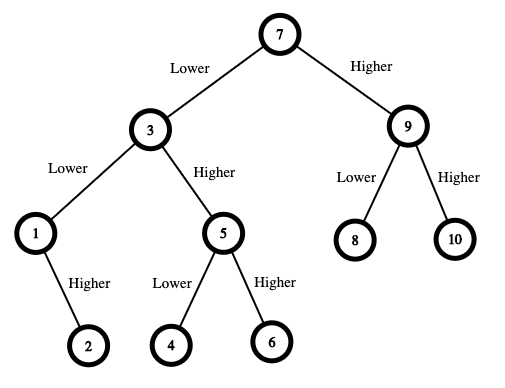

# 375. Guess Number Higher or Lower II

## Problem Statement

We are playing the Guessing Game. The game works as follows:

- I pick a number between `1` and `n`.
- You guess a number.
- If you guess the right number, you win the game.
- If you guess the wrong number:
  - I will tell you whether the number is **higher or lower**
  - You continue guessing
- Every time you guess a wrong number `x`, you **pay `x` dollars**
- If you run out of money, you lose

### Goal

Return the **minimum amount of money required to guarantee a win**, regardless of what number is picked.

---

## Examples

### Example 1

**Input:**

```
n = 10
```

**Output:**

```
16
```

**Explanation:**



The optimal strategy ensures that the **worst-case cost** is minimized.

- Start with range `[1,10]`, guess `7`
  - If correct → cost = 0
  - Else pay `7`
  - If higher → `[8,10]`
    - Guess `9`
      - If correct → total = 7
      - Else pay `9`
      - If higher → guess `10` → total = 16
      - If lower → guess `8` → total = 16
  - If lower → `[1,6]`
    - Guess `3`
      - If correct → total = 7
      - Else pay `3`
      - If higher → `[4,6]`
        - Guess `5`
          - If correct → total = 10
          - Else pay `5`
          - If higher → guess `6` → total = 15
          - If lower → guess `4` → total = 15
      - If lower → `[1,2]`
        - Guess `1`
          - If correct → total = 10
          - Else pay `1`
          - Guess `2` → total = 11

Worst-case cost = **16**

---

### Example 2

**Input:**

```
n = 1
```

**Output:**

```
0
```

**Explanation:**

Only one number → guess correctly immediately → no cost

---

### Example 3

**Input:**

```
n = 2
```

**Output:**

```
1
```

**Explanation:**

- Guess `1`
  - If correct → cost = 0
  - Else pay `1`, guess `2` → total = 1

Worst-case = **1**

---

## Constraints

- `1 <= n <= 200`
