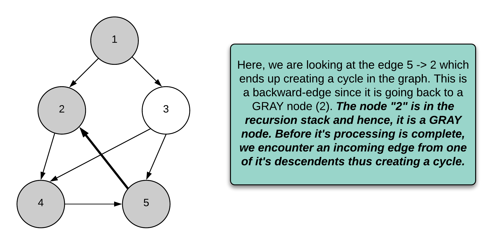
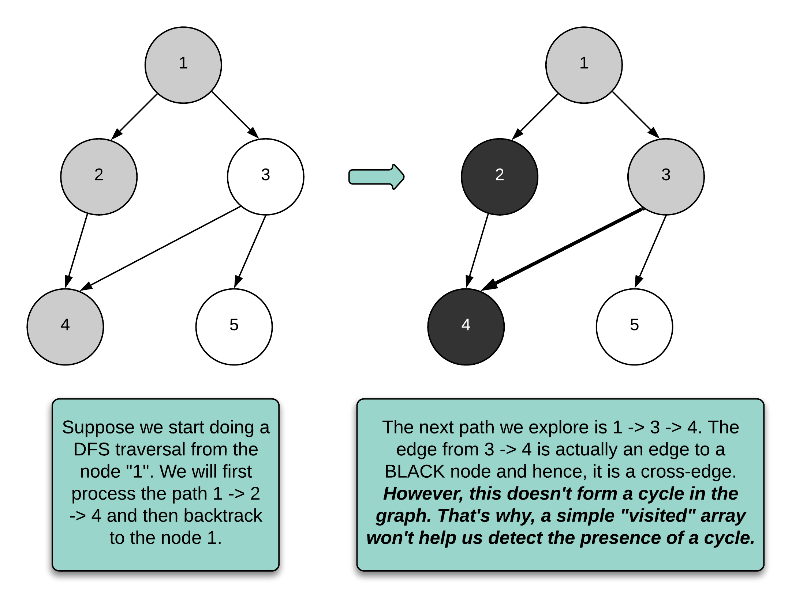

## Detailed Notes on the Depth-First Search Approach

## Overview

We are given:

- a **directed graph**
- a **source** node
- a **destination** node

We need to determine whether **all possible paths starting from `source` eventually lead to `destination`**.

At first glance, the problem statement may look long, but it can be broken into a few simple conditions.



---

# Restating the Problem in Simpler Terms

We need to check whether **every possible path** starting at `source` satisfies all of the following:

## 1. At least one path reaches `destination`

There must be some valid route from `source` to `destination`.

---

## 2. No path gets stuck at the wrong place

If we ever reach a node with **no outgoing edges**, then that node must be exactly `destination`.

So if any path can end at a dead-end node other than `destination`, the answer is `false`.

---

## 3. There must not be infinitely many paths

If there is a cycle reachable from `source`, then we could keep looping forever.

That would mean the number of possible paths is not finite.

So if a reachable cycle exists, the answer must be `false`.

---

# What the Problem Really Boils Down To

Once simplified, the problem becomes:

1. detect whether a reachable cycle exists
2. ensure every reachable leaf node is exactly the destination

That is the essence of the problem.

---

# Why Graph Traversal Is the Right Tool

This is a directed graph problem, so the natural tools are:

- **Depth-First Search (DFS)**
- **Breadth-First Search (BFS)**

The editorial chooses DFS, which is the most natural option here because:

- checking leaf nodes is easy during recursion
- cycle detection in directed graphs is elegant with DFS using **node coloring**



---

# Approach: Depth-First Search

## Intuition

DFS explores paths deeply before backtracking.

That is extremely useful here because:

- if we ever reach a dead-end, we can immediately verify whether it is the destination
- if we ever revisit a node that is still being processed, then we found a cycle

To support this, the algorithm uses the standard **three-color DFS idea** from CLRS.

---

# Node Coloring Technique

Each node can conceptually be in one of three states:

## WHITE

The node has not been processed yet.

In the given implementation, WHITE is represented implicitly by:

```java
null
```

inside the `states` array.

---

## GRAY

The node is currently being processed.

That means:

- DFS has entered this node
- but DFS has **not yet finished** exploring all descendants

So a GRAY node is effectively a node that is still in the recursion stack.

---

## BLACK

The node and all paths below it have already been fully processed.

That means:

- all paths from that node have already been verified
- it is safe to reuse that result

---

# Why Encountering a GRAY Node Means a Cycle

Suppose during DFS we are currently exploring node `u`, and from there we follow an edge to a node `v`.

If `v` is already **GRAY**, that means:

- `v` is still in the current recursion chain
- so we have found a path back to an ancestor in the active DFS stack

That is exactly a **back edge**, which means the graph contains a directed cycle.

Since the problem requires the number of paths to be finite, any reachable cycle means the answer must be:

```text
false
```

---

# Why BLACK Nodes Can Be Reused

If a node is BLACK, it means we already finished checking every path starting from that node.

So if DFS reaches that node again later, we do not need to recompute its subtree.

This helps avoid repeated work.

---

# High-Level Algorithm

We define a recursive function:

```java
leadsToDest(graph, node, destination, states)
```

This function returns:

- `true` if all paths starting from `node` lead to `destination`
- `false` otherwise

Then:

1. build the adjacency list for the directed graph
2. call DFS from `source`
3. use the coloring logic to detect cycles
4. when a leaf node is reached, verify that it is the destination

---

# Detailed Logic of the DFS

For a given `node`:

## Case 1: node is already GRAY

That means we found a cycle.

Return `false`.

## Case 2: node is already BLACK

That means it has already been validated successfully.

Return `true`.

## Case 3: node has no outgoing edges

Then this is a leaf node.

Return:

```java
node == destination
```

If the leaf is not the destination, then a path ends at the wrong place, so return `false`.

## Case 4: node is unvisited

Mark it GRAY and recursively process all outgoing neighbors.

If any neighbor returns `false`, propagate `false`.

If all neighbors succeed, mark the node BLACK and return `true`.

---

# Java Code

```java
class Solution {

    // We don't use the state WHITE as such anywhere.
    // Instead, the "null" value in the states array below
    // is a substitute for WHITE.
    enum Color { GRAY, BLACK };

    public boolean leadsToDestination(int n, int[][] edges, int source, int destination) {

        List<Integer>[] graph = buildDigraph(n, edges);
        return leadsToDest(graph, source, destination, new Color[n]);
    }

    private boolean leadsToDest(List<Integer>[] graph, int node, int dest, Color[] states) {

        // If the state is GRAY, this is a backward edge and hence, it creates a loop.
        if (states[node] != null) {
            return states[node] == Color.BLACK;
        }

        // If this is a leaf node, it should be equal to the destination.
        if (graph[node].isEmpty()) {
            return node == dest;
        }

        // Now, we are processing this node. So we mark it as GRAY
        states[node] = Color.GRAY;

        for (int next : graph[node]) {

            // If we get a `false` from any recursive call on the neighbors,
            // we short circuit and return from there.
            if (!leadsToDest(graph, next, dest, states)) {
                return false;
            }
        }

        // Recursive processing done for the node. We mark it BLACK
        states[node] = Color.BLACK;
        return true;
    }

    private List<Integer>[] buildDigraph(int n, int[][] edges) {
        List<Integer>[] graph = new List[n];
        for (int i = 0; i < n; i++) {
            graph[i] = new ArrayList<>();
        }

        for (int[] edge : edges) {
            graph[edge[0]].add(edge[1]);
        }

        return graph;
    }
}
```

---

# Detailed Walkthrough of the Code

## Step 1: Build the directed graph

```java
private List<Integer>[] buildDigraph(int n, int[][] edges) {
    List<Integer>[] graph = new List[n];
    for (int i = 0; i < n; i++) {
        graph[i] = new ArrayList<>();
    }

    for (int[] edge : edges) {
        graph[edge[0]].add(edge[1]);
    }

    return graph;
}
```

This creates an adjacency list for the directed graph.

Because the graph is directed, we add only:

```java
edge[0] -> edge[1]
```

and not the reverse edge.

---

## Step 2: Start DFS from source

```java
return leadsToDest(graph, source, destination, new Color[n]);
```

The `states` array tracks whether each node is:

- unvisited (`null`)
- GRAY
- BLACK

---

## Step 3: Already-seen node logic

```java
if (states[node] != null) {
    return states[node] == Color.BLACK;
}
```

This is compact and elegant.

### If node is BLACK

Return `true`, because we already proved that all paths from this node lead correctly to destination.

### If node is GRAY

Return `false`, because we found a back edge and therefore a cycle.

---

## Step 4: Leaf node check

```java
if (graph[node].isEmpty()) {
    return node == dest;
}
```

This is the second major condition in the problem.

If a path ends here and this node is not the destination, then not all paths lead to the destination.

So this immediately fails.

---

## Step 5: Mark node as GRAY

```java
states[node] = Color.GRAY;
```

This means we are currently exploring this node.

If we come back to it before finishing, a cycle exists.

---

## Step 6: Explore all outgoing edges

```java
for (int next : graph[node]) {
    if (!leadsToDest(graph, next, dest, states)) {
        return false;
    }
}
```

Every outgoing path must be valid.

So if even one neighbor leads to failure, the current node must also fail.

---

## Step 7: Mark node as BLACK

```java
states[node] = Color.BLACK;
return true;
```

At this point:

- all descendants have been processed
- no bad leaf was found
- no cycle was found

So this node is safe.

---

# Example Reasoning

## Example 1

```text
n = 3
edges = [[0,1],[0,2]]
source = 0
destination = 2
```

Graph:

```text
0 -> 1
0 -> 2
```

Node `1` is a leaf.
But `1 != 2`.

So there is a path from `0` that ends at the wrong place.

Answer:

```text
false
```

---

## Example 2

```text
n = 4
edges = [[0,1],[0,3],[1,2],[2,1]]
source = 0
destination = 3
```

Graph:

```text
0 -> 1 -> 2
     ^    |
     |____|

0 -> 3
```

There is a cycle between `1` and `2`.

That means there are infinitely many paths from `0` if we keep looping there.

So answer is:

```text
false
```

---

## Example 3

```text
n = 4
edges = [[0,1],[0,2],[1,3],[2,3]]
source = 0
destination = 3
```

Graph:

```text
0 -> 1 -> 3
0 -> 2 -> 3
```

Every path ends at node `3`.

There are no cycles.
There are no wrong leaf nodes.

Answer:

```text
true
```

---

# Why DFS Is Better Than BFS Here

The editorial specifically argues against BFS for this problem in an interview context.

The reason is that:

- cycle detection in **directed graphs** is naturally handled by DFS with node coloring
- BFS does not give such a clean standard mechanism for detecting directed cycles during path validation
- DFS recursion stack directly corresponds to the notion of “currently active path,” which is exactly what GRAY nodes represent

So DFS is the most natural and interview-friendly choice here.

---

# Complexity Analysis

Let:

- `V` = number of vertices
- `E` = number of edges

## Time Complexity

The DFS processes each node at most once meaningfully, because:

- once a node becomes BLACK, future calls return immediately
- cycle detection prunes bad paths early

A standard DFS over a graph is:

```text
O(V + E)
```

The editorial text discusses worst-case density and pruning, but the clearest standard bound for this implementation is:

```text
O(V + E)
```

Since:

- building the adjacency list costs `O(V + E)`
- DFS also costs `O(V + E)`

the total remains linear in graph size.

---

## Space Complexity

```text
O(V + E)
```

Why?

### Adjacency list

Stores all outgoing edges:

```text
O(V + E)
```

### Color states array

Stores one state per node:

```text
O(V)
```

### Recursion stack

In the worst case, recursion depth can reach `O(V)`.

So total auxiliary space is:

```text
O(V + E)
```

---

# Why the Destination Must Be a Leaf if Reached as a Terminal Node

One subtle point is that even the destination itself must not have outgoing edges if all paths are supposed to end there.

Why?

Because if `destination` had outgoing edges, then a path could continue beyond it.

That would mean the path does not truly “end” at the destination.

The given DFS logic automatically handles this because:

- if a node has outgoing edges, DFS continues exploring them
- so if destination has outgoing edges leading somewhere bad, the answer will become false

---

# Strengths of This Approach

- clean DFS-based reasoning
- elegant cycle detection via coloring
- naturally handles dead-end checking
- avoids repeated work using BLACK memoization
- highly interview-friendly

---

# Potential Pitfalls

## 1. Using only a visited array

A plain visited array is not enough for cycle detection in directed graphs.

You need to distinguish:

- currently exploring
- fully processed

That is exactly why GRAY and BLACK are needed.

---

## 2. Forgetting the leaf-node rule

Even if there are no cycles, the answer is false if any reachable dead-end node is not the destination.

---

## 3. Assuming any path to destination is enough

The requirement is stronger:

> all paths from source must lead to destination

Not just one.

---

# Final Takeaway

This problem is best understood as:

> verify that every path starting from `source` is forced to eventually terminate at `destination`, with no wrong dead ends and no infinite cycles

DFS with node coloring is ideal for this because it allows us to check both required conditions at the same time:

- leaf nodes must equal destination
- GRAY revisits indicate cycles

That makes the solution both elegant and efficient.

---

# Summary

## Main Conditions to Check

1. At least one path must lead from source to destination
2. Any reachable leaf node must be destination
3. No reachable cycle may exist

## Main Idea

Use DFS with graph coloring.

- `null` = WHITE (unvisited)
- `GRAY` = currently processing
- `BLACK` = fully processed and valid

## Core Logic

- if we hit a GRAY node, there is a cycle → return false
- if we hit a leaf, it must equal destination
- recursively verify all outgoing neighbors
- mark node BLACK once finished

## Complexity

- **Time:** `O(V + E)`
- **Space:** `O(V + E)`

## Recommended

DFS with node coloring is the cleanest and most standard solution for this problem.
