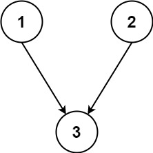
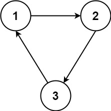

# 1136. Parallel Courses

## Problem Statement

You are given an integer **n**, which represents the number of courses labeled from **1 to n**.

You are also given an array **relations** where:

```
relations[i] = [prevCoursei, nextCoursei]
```

This indicates a prerequisite relationship:

- **prevCoursei must be completed before nextCoursei**

In other words:

```
prevCoursei → nextCoursei
```

This forms a **directed graph** where:

- Courses are **nodes**
- Prerequisites are **directed edges**

---

# Goal

Determine the **minimum number of semesters** required to complete all courses.

### Rule

In **one semester**, you can take **any number of courses** as long as:

- All prerequisites of those courses were completed in **previous semesters**.

---

# Return Value

Return:

```
Minimum number of semesters needed to finish all courses
```

If it is **impossible** to finish all courses due to cyclic prerequisites, return:

```
-1
```

---

# Example 1



```
Input:
n = 3
relations = [[1,3],[2,3]]
```

### Graph Representation

```
1 → 3
2 → 3
```

### Explanation

Semester 1:

```
Take courses: 1, 2
```

Semester 2:

```
Take course: 3
```

### Output

```
2
```

---

# Example 2



```
Input:
n = 3
relations = [[1,2],[2,3],[3,1]]
```

### Graph Representation

```
1 → 2 → 3 → 1
```

This forms a **cycle**.

### Explanation

Each course depends on another in the cycle:

```
1 needs 3
3 needs 2
2 needs 1
```

Therefore **no course can be taken first**.

### Output

```
-1
```

---

# Constraints

```
1 <= n <= 5000
1 <= relations.length <= 5000
relations[i].length == 2
1 <= prevCoursei, nextCoursei <= n
prevCoursei != nextCoursei
All pairs are unique
```

---

# Key Observations

This problem is essentially a **graph problem involving prerequisites**.

Important properties:

- The graph is **directed**
- A cycle makes the schedule **impossible**
- Courses with **no prerequisites** can be taken immediately
- After completing them, their dependent courses become available

Thus, the problem is closely related to:

```
Topological Sorting
```

---

# Graph Interpretation

We model the input as:

```
Directed Graph (DAG if valid)
```

Where:

- Nodes = courses
- Edge A → B means **A must be taken before B**

---

# What We Need To Compute

We need to determine:

```
Number of levels in the DAG
```

Each **level corresponds to a semester**.

Courses with **no remaining prerequisites** can be taken simultaneously.

---

# When Is It Impossible?

If the graph contains a **cycle**, then:

- No valid ordering exists
- The topological sort fails
- The answer must be:

```
-1
```

---

# Conceptual Summary

| Concept        | Meaning                |
| -------------- | ---------------------- |
| Node           | Course                 |
| Edge           | Prerequisite           |
| Graph Type     | Directed               |
| Valid Schedule | Directed Acyclic Graph |
| Goal           | Longest layer count    |
| Failure Case   | Cycle present          |

---

# Final Interpretation

The problem reduces to:

```
Find the number of layers in a topologically sorted DAG.
```

Each layer represents **one semester**.

---

# Short Summary

- Model courses as a directed graph
- Edges represent prerequisite relationships
- Detect cycles (impossible schedule)
- Otherwise count the number of layers needed to process all courses
- Each layer corresponds to a semester
