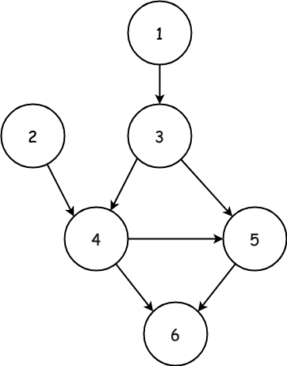
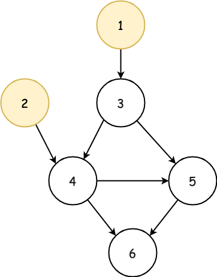
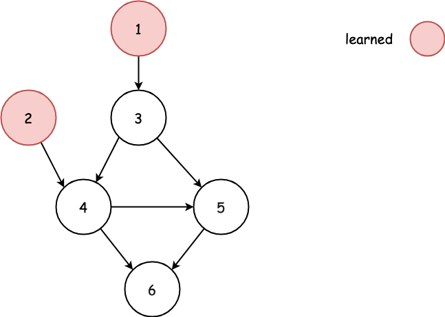
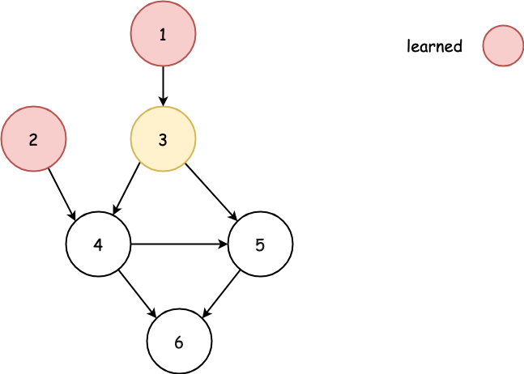

## Detailed Notes on BFS and DFS Approaches

## Overview

We are given `n` courses labeled from `1` to `n`.

We are also given prerequisite relations:

```text
prevCourse -> nextCourse
```

meaning that `prevCourse` must be completed before `nextCourse`.

In one semester, we may take **any number of courses** as long as all of their prerequisites were completed in previous semesters.

The goal is to compute:

- the **minimum number of semesters** needed to finish all courses
- or return `-1` if it is impossible because of a cycle

This is a classic **directed graph** problem and can be solved with **topological sorting**.

This write-up explains three approaches:

1. **Breadth-First Search (Kahn’s Algorithm)**
2. **Depth-First Search: Check Cycles + Find Longest Path**
3. **Depth-First Search: Combined Version**

---

# Core Graph Interpretation

This problem can be modeled as a directed graph:

- each course is a node
- each prerequisite relation is a directed edge
- an edge:
  ```text
  A -> B
  ```
  means course `A` must be taken before course `B`

If the graph contains a cycle, then no valid order of taking courses exists.

If the graph is acyclic, then the problem becomes:

> How many layers of prerequisite dependencies are there?

Because each semester can take all currently available courses in parallel, the number of semesters is closely tied to the **longest dependency chain**.

---

# Two Big Ideas Behind the Problem

There are two equivalent ways to think about the answer.

## View 1: Layered Topological Sorting

In each semester, take every course whose prerequisites are already satisfied.

The number of BFS layers equals the number of semesters.

## View 2: Longest Path in a DAG

If the graph has no cycle, then the minimum number of semesters equals the length of the longest path in the graph.

For example, if we must take:

```text
1 -> 4 -> 7 -> 9
```

then these courses force at least 4 semesters.

---

# Approach 1: Breadth-First Search (Kahn’s Algorithm)

## Intuition

This is the most direct and interview-friendly solution.

The rule for the fastest schedule is:

> In each semester, take all currently available courses.

This is always optimal because delaying an available course cannot help us finish earlier.
If a course is already unlocked, taking it now can only help unlock future courses sooner.

So the plan is:

1. identify all courses with no prerequisites
2. take all of them in semester 1
3. remove their outgoing edges
4. identify new courses whose prerequisites are now satisfied
5. take all of those in semester 2
6. continue until no more courses are available

If we manage to study all courses, the number of BFS layers is the answer.

If some courses remain unprocessed, the graph must contain a cycle, so return `-1`.





---

## Why In-Degree Matters

For each course, we count how many prerequisites it still has.

This is called its **in-degree**.

- in-degree `0` means the course is ready to be taken now
- once a prerequisite is completed, the in-degree of its dependent courses decreases
- when a course’s in-degree becomes `0`, it becomes available in the next semester





---

## Algorithm

1. Build the directed graph from `relations`.
2. Compute the in-degree of every course.
3. Put all courses with in-degree `0` into a queue/list.
4. Repeatedly process one semester at a time:
   - take all courses currently in the queue
   - decrement in-degree of their neighbors
   - if a neighbor becomes in-degree `0`, add it to the next semester’s queue
5. Count how many courses were studied.
6. If studied count equals `N`, return semester count; otherwise return `-1`.

---

## Java Code

```java
class Solution {
    public int minimumSemesters(int N, int[][] relations) {
        int[] inCount = new int[N + 1]; // or indegree
        List<List<Integer>> graph = new ArrayList<>(N + 1);
        for (int i = 0; i < N + 1; ++i) {
            graph.add(new ArrayList<Integer>());
        }
        for (int[] relation : relations) {
            graph.get(relation[0]).add(relation[1]);
            inCount[relation[1]]++;
        }
        int step = 0;
        int studiedCount = 0;
        List<Integer> bfsQueue = new ArrayList<>();
        for (int node = 1; node < N + 1; node++) {
            if (inCount[node] == 0) {
                bfsQueue.add(node);
            }
        }
        // start learning with BFS
        while (!bfsQueue.isEmpty()) {
            // start new semester
            step++;
            List<Integer> nextQueue = new ArrayList<>();
            for (int node : bfsQueue) {
                studiedCount++;
                for (int endNode : graph.get(node)) {
                    inCount[endNode]--;
                    // if all prerequisite courses learned
                    if (inCount[endNode] == 0) {
                        nextQueue.add(endNode);
                    }
                }
            }
            bfsQueue = nextQueue;
        }

        // check if learn all courses
        return studiedCount == N ? step : -1;
    }
}
```

---

## Detailed Walkthrough

### Step 1: Build adjacency list

```java
List<List<Integer>> graph = new ArrayList<>(N + 1);
for (int i = 0; i < N + 1; ++i) {
    graph.add(new ArrayList<Integer>());
}
for (int[] relation : relations) {
    graph.get(relation[0]).add(relation[1]);
}
```

This creates the graph where `prevCourse -> nextCourse`.

---

### Step 2: Build in-degree counts

```java
int[] inCount = new int[N + 1];
for (int[] relation : relations) {
    inCount[relation[1]]++;
}
```

Each prerequisite edge increases the in-degree of the destination course.

---

### Step 3: Initialize first semester

```java
List<Integer> bfsQueue = new ArrayList<>();
for (int node = 1; node < N + 1; node++) {
    if (inCount[node] == 0) {
        bfsQueue.add(node);
    }
}
```

Courses with no prerequisites can be taken immediately.

---

### Step 4: Process one semester at a time

```java
while (!bfsQueue.isEmpty()) {
    step++;
    List<Integer> nextQueue = new ArrayList<>();
    ...
    bfsQueue = nextQueue;
}
```

Each iteration of the outer loop corresponds to **one semester**.

---

### Step 5: Process all available courses in the semester

```java
for (int node : bfsQueue) {
    studiedCount++;
    for (int endNode : graph.get(node)) {
        inCount[endNode]--;
        if (inCount[endNode] == 0) {
            nextQueue.add(endNode);
        }
    }
}
```

This simulates learning all currently available courses in parallel.

---

### Step 6: Detect cycle or success

```java
return studiedCount == N ? step : -1;
```

If we could not process all courses, then some were trapped in a cycle.

---

## Why This Minimizes Semesters

At each semester, we take every course that is available.

If we intentionally skipped one, then:

- we would still need to take it later
- and any course depending on it would also be delayed

So taking all available courses each semester is always optimal.

---

## Complexity Analysis

Let `E` be the number of relations.

### Time Complexity

```text
O(N + E)
```

Why?

- graph construction takes `O(N + E)`
- BFS processes each node and edge once

### Space Complexity

```text
O(N + E)
```

Why?

- adjacency list uses `O(N + E)`
- queue can hold up to `O(N)` courses

---

# Approach 2: DFS — Check for Cycles + Find Longest Path

## Intuition

There is an important insight:

> If the graph is acyclic, the minimum number of semesters equals the length of the longest path in the graph.

Why?

Because each edge means one course must come before another.
So along a dependency chain, each new course must wait for a later semester.

For example:

```text
1 -> 3 -> 5 -> 8
```

forces 4 semesters for those courses.

However, this only works if the graph is a DAG.

If there is a cycle, the longest path is effectively unbounded and the schedule is impossible.

So this approach splits the problem into two parts:

1. check whether the graph has a cycle
2. if not, compute the longest path

---

# Part A: Cycle Detection with DFS

We use a standard three-state DFS marking scheme.

Each node can be:

- `0` = unvisited
- `-1` = visiting
- `1` = visited

If during DFS we reach a node already marked `-1`, then we found a back edge and therefore a cycle.

---

# Part B: Longest Path with DFS + Memoization

Once we know there is no cycle, we compute the longest path starting from each node.

Let:

```text
dfsMaxPath(node)
```

return the length of the longest path starting from `node`, counting `node` itself.

Then:

```text
dfsMaxPath(node) = 1 + max(dfsMaxPath(child))
```

over all children of `node`.

If `node` has no outgoing edges, its longest path length is `1`.

To avoid repeated recomputation, we memoize results.

---

## Algorithm

1. Build the graph.
2. Run DFS cycle detection from every node.
3. If a cycle is found, return `-1`.
4. Otherwise, run DFS longest-path computation from every node.
5. Return the maximum path length found.

---

## Java Code

```java
class Solution {
    public int minimumSemesters(int N, int[][] relations) {
        List<List<Integer>> graph = new ArrayList<>(N + 1);
        for (int i = 0; i < N + 1; ++i) {
            graph.add(new ArrayList<Integer>());
        }
        for (int[] relation : relations) {
            graph.get(relation[0]).add(relation[1]);
        }
        // check if the graph contains a cycle
        int[] visited = new int[N + 1];
        for (int node = 1; node < N + 1; node++) {
            // if has cycle, return -1
            if (dfsCheckCycle(node, graph, visited) == -1) {
                return -1;
            }
        }

        // if no cycle, return the longest path
        int[] visitedLength = new int[N + 1];
        int maxLength = 1;
        for (int node = 1; node < N + 1; node++) {
            int length = dfsMaxPath(node, graph, visitedLength);
            maxLength = Math.max(length, maxLength);
        }
        return maxLength;
    }

    private int dfsCheckCycle(int node, List<List<Integer>> graph, int[] visited) {
        // return -1 if has a cycle
        // return 1 if does not have any cycle
        if (visited[node] != 0) {
            return visited[node];
        } else {
            // mark as visiting
            visited[node] = -1;
        }
        for (int endNode : graph.get(node)) {
            if (dfsCheckCycle(endNode, graph, visited) == -1) {
                // we meet a cycle!
                return -1;
            }
        }
        // mark as visited
        visited[node] = 1;
        return 1;
    }

    private int dfsMaxPath(int node, List<List<Integer>> graph, int[] visitedLength) {
        // return the longest path (inclusive)
        if (visitedLength[node] != 0) {
            return visitedLength[node];
        }
        int maxLength = 1;
        for (int endNode : graph.get(node)) {
            int length = dfsMaxPath(endNode, graph, visitedLength);
            maxLength = Math.max(length + 1, maxLength);
        }
        // store it
        visitedLength[node] = maxLength;
        return maxLength;
    }
}
```

---

## Detailed Walkthrough

### Cycle detection array

```java
int[] visited = new int[N + 1];
```

Interpretation:

- `0` = unvisited
- `-1` = currently exploring
- `1` = fully processed

---

### `dfsCheckCycle(...)`

```java
if (visited[node] != 0) {
    return visited[node];
}
visited[node] = -1;
...
visited[node] = 1;
```

This is classic directed graph cycle detection.

If a node is reached while still marked `-1`, a cycle exists.

---

### Longest path memo array

```java
int[] visitedLength = new int[N + 1];
```

This stores the longest path starting from each node so we do not recompute it.

---

### `dfsMaxPath(...)`

```java
if (visitedLength[node] != 0) {
    return visitedLength[node];
}
int maxLength = 1;
for (int endNode : graph.get(node)) {
    int length = dfsMaxPath(endNode, graph, visitedLength);
    maxLength = Math.max(length + 1, maxLength);
}
visitedLength[node] = maxLength;
return maxLength;
```

The `+1` accounts for the current node itself.

---

## Why This Works

If the graph is acyclic, every prerequisite chain defines a sequence of semesters.

The longest such chain determines the minimum total number of semesters needed.

Parallelism helps with shorter chains, but it cannot reduce the length of the longest dependency chain.

So the answer is exactly the longest path length.

---

## Complexity Analysis

### Time Complexity

```text
O(N + E)
```

Why?

- graph construction is `O(N + E)`
- cycle detection DFS visits each node and edge once
- longest path DFS with memoization also visits each node and edge once overall

### Space Complexity

```text
O(N + E)
```

Why?

- adjacency list uses `O(N + E)`
- recursion stack and arrays use `O(N)`

---

# Approach 3: DFS — Combined Version

## Intuition

Approach 2 works well, but it runs two separate DFS passes:

1. one for cycle detection
2. one for longest path

We can combine them into a single DFS.

The idea is to let the `visited` array play a dual role:

- `-1` means the node is currently being explored → cycle detection
- positive value means DFS already finished, and that positive value is the longest path starting from this node

So now one DFS function can both:

- detect cycles
- compute longest path length

---

# Key State Meaning

In the combined DFS:

- `0` = unvisited
- `-1` = visiting (currently in recursion stack)
- `> 0` = fully processed, and the value itself is the longest path length from this node

---

## Algorithm

1. Build the graph.
2. Initialize `visited` array with all zeros.
3. For each node, run DFS.
4. If DFS returns `-1`, a cycle exists → return `-1`.
5. Otherwise, track the maximum returned path length.
6. Return that maximum.

---

## Java Code

```java
class Solution {
    public int minimumSemesters(int N, int[][] relations) {
        List<List<Integer>> graph = new ArrayList<>(N + 1);
        for (int i = 0; i < N + 1; ++i) {
            graph.add(new ArrayList<Integer>());
        }
        for (int[] relation : relations) {
            graph.get(relation[0]).add(relation[1]);
        }
        int[] visited = new int[N + 1];

        int maxLength = 1;
        for (int node = 1; node < N + 1; node++) {
            int length = dfs(node, graph, visited);
            // we meet a cycle!
            if (length == -1) {
                return -1;
            }
            maxLength = Math.max(length, maxLength);
        }
        return maxLength;
    }

    private int dfs(int node, List<List<Integer>> graph, int[] visited) {
        // return the longest path (inclusive)
        if (visited[node] != 0) {
            return visited[node];
        } else {
            // mark as visiting
            visited[node] = -1;
        }
        int maxLength = 1;
        for (int endNode : graph.get(node)) {
            int length = dfs(endNode, graph, visited);
            // we meet a cycle!
            if (length == -1) {
                return -1;
            }
            maxLength = Math.max(length + 1, maxLength);
        }
        // mark as visited
        visited[node] = maxLength;
        return maxLength;
    }
}
```

---

## Detailed Walkthrough

### Entry condition

```java
if (visited[node] != 0) {
    return visited[node];
}
```

There are two possibilities here:

- if `visited[node] == -1`, then we hit a cycle
- if `visited[node] > 0`, we already know the longest path from this node

So this single line handles both memoization and cycle detection.

---

### Mark as visiting

```java
visited[node] = -1;
```

This means the node is now on the recursion stack.

If DFS reaches it again before completion, the graph has a cycle.

---

### Explore children

```java
for (int endNode : graph.get(node)) {
    int length = dfs(endNode, graph, visited);
    if (length == -1) {
        return -1;
    }
    maxLength = Math.max(length + 1, maxLength);
}
```

This computes the longest child path, while immediately propagating cycle detection failure.

---

### Store the result

```java
visited[node] = maxLength;
return maxLength;
```

Now the node is fully processed.
Its array entry becomes its longest path length.

---

## Why This Version Is Better

Compared with Approach 2:

- one DFS instead of two
- same asymptotic complexity
- cleaner once the state meaning is understood

This is why the editorial recommends Approach 3 together with Approach 1.

---

## Complexity Analysis

### Time Complexity

```text
O(N + E)
```

Why?

- graph construction is `O(N + E)`
- each node and edge is processed once in DFS

### Space Complexity

```text
O(N + E)
```

Why?

- adjacency list uses `O(N + E)`
- recursion stack and state array use `O(N)`

---

# Comparing the Three Approaches

## Approach 1: BFS / Kahn’s Algorithm

### Main idea

Take all currently available courses each semester.

### Strengths

- very intuitive
- directly simulates semesters
- easiest to explain in an interview

### Time

```text
O(N + E)
```

### Space

```text
O(N + E)
```

---

## Approach 2: DFS in Two Phases

### Main idea

First detect cycles, then compute longest path.

### Strengths

- clear conceptual separation
- helps understand the relationship between cycles and longest path

### Weaknesses

- runs DFS twice

### Time

```text
O(N + E)
```

### Space

```text
O(N + E)
```

---

## Approach 3: Combined DFS

### Main idea

Use one DFS to both detect cycles and compute longest path.

### Strengths

- elegant
- avoids duplicate traversal
- same efficiency as BFS

### Time

```text
O(N + E)
```

### Space

```text
O(N + E)
```

---

# Which Approach Should You Prefer?

## For interviews

Use **Approach 1 (BFS / Kahn’s Algorithm)**.

It is the most straightforward:

- easy to explain
- directly models semesters
- naturally handles cycle detection through unfinished nodes

## For deeper graph understanding

Use **Approach 3 (combined DFS)**.

It is elegant and teaches the important idea that:

> minimum semesters = longest path in a DAG

provided no cycle exists.

---

# Final Takeaway

This problem is fundamentally a **topological ordering** problem on a directed graph.

There are two equivalent ways to solve it:

1. **BFS layering:** number of semesters = number of BFS layers
2. **DFS longest path:** number of semesters = longest path length in a DAG

If the graph contains a cycle, then the answer is always `-1`.

That makes the problem a nice combination of:

- cycle detection
- topological sorting
- dependency scheduling

---

# Summary

## Problem Interpretation

Courses are nodes, prerequisites are directed edges.

## Important Facts

- If a cycle exists, return `-1`
- Otherwise, the answer is the minimum number of layers / longest dependency chain

## Approaches

### 1. BFS (Kahn’s Algorithm)

- take all zero-indegree nodes every semester
- count BFS levels
- **Time:** `O(N + E)`
- **Space:** `O(N + E)`

### 2. DFS (Cycle Check + Longest Path)

- first detect cycles
- then compute longest path with memoization
- **Time:** `O(N + E)`
- **Space:** `O(N + E)`

### 3. DFS (Combined)

- one DFS handles both cycle detection and longest path
- **Time:** `O(N + E)`
- **Space:** `O(N + E)`

## Recommended

- **Approach 1** for simplicity and interview clarity
- **Approach 3** for elegance and strong graph insight
