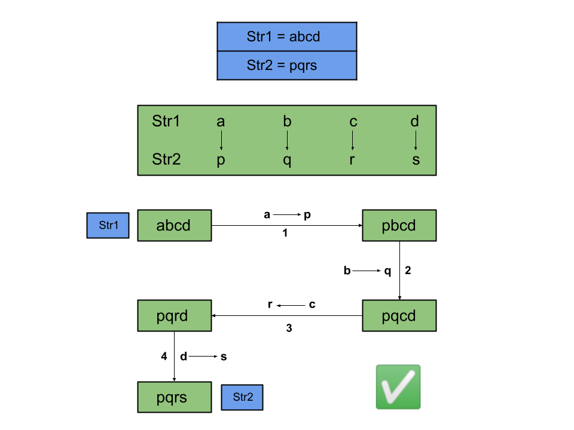
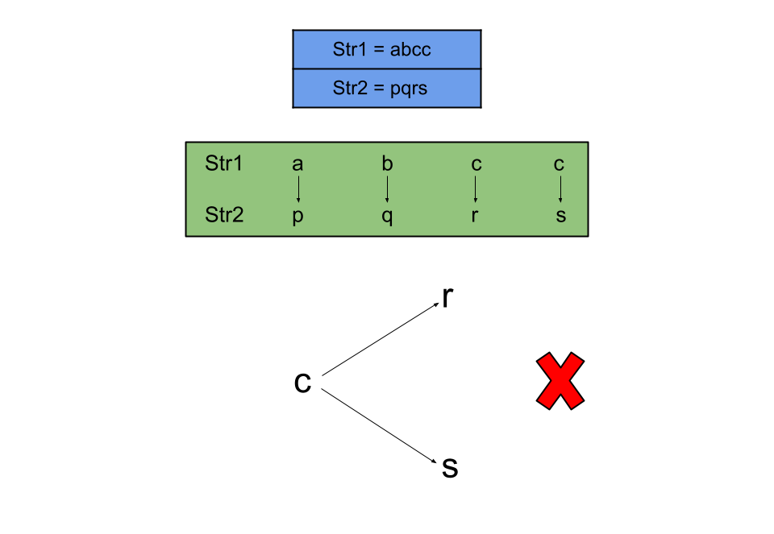
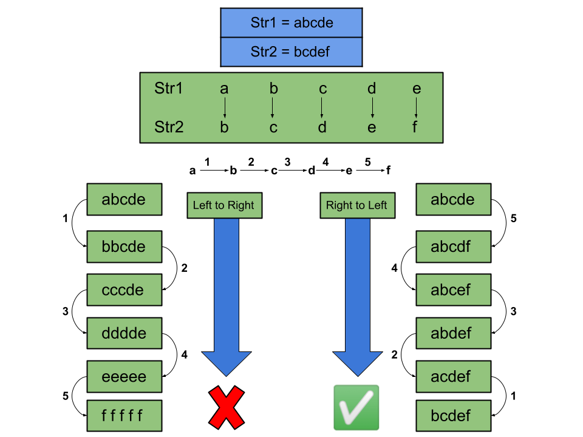
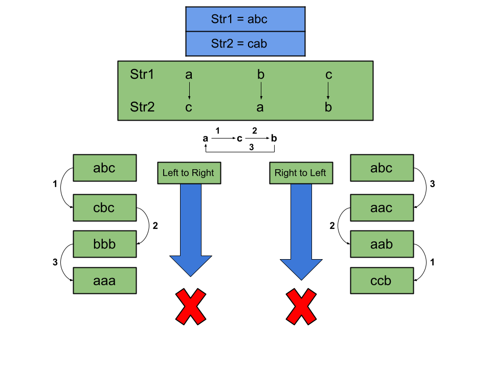
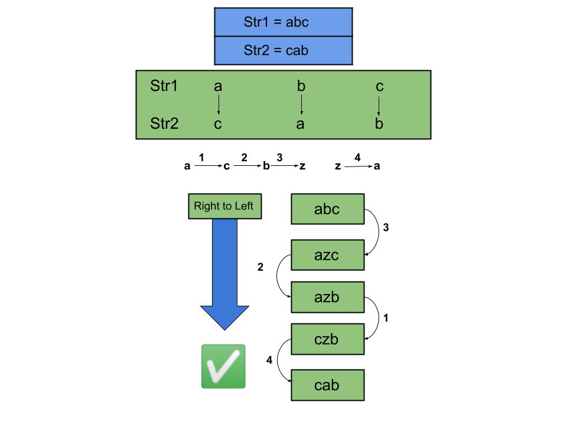
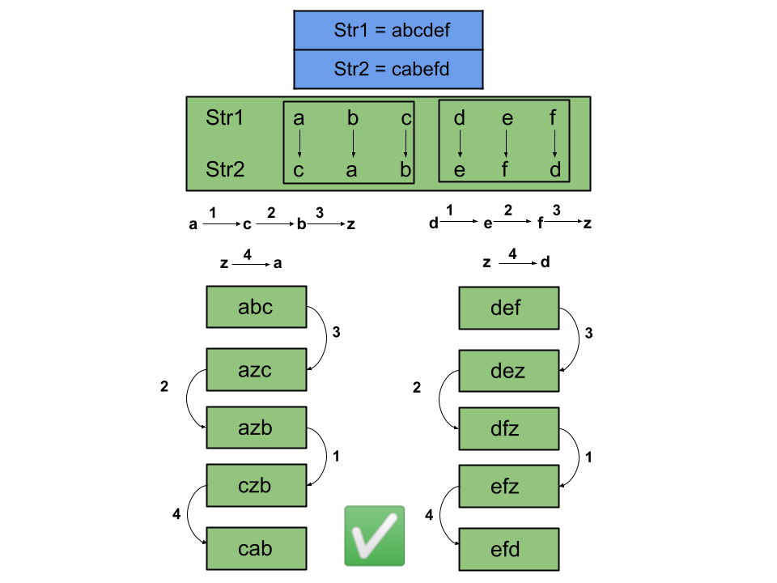
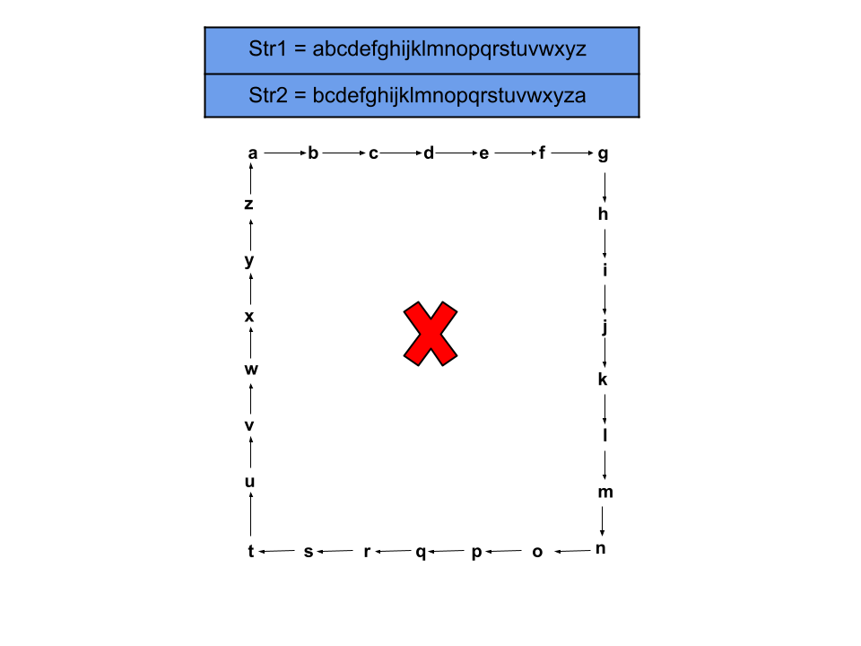
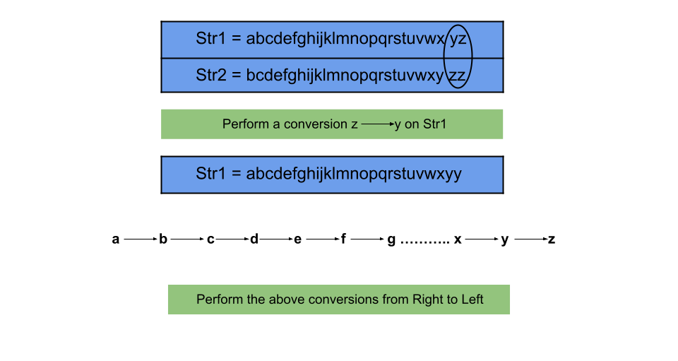

## Detailed Notes on the Greedy + Hashing Approach

## Overview

We are given two strings:

- `str1`
- `str2`

Both have the same length, and both contain only lowercase English letters.

We want to determine whether `str1` can be transformed into `str2` using zero or more conversion operations.

A single conversion operation allows us to:

- choose one character in `str1`
- convert **all occurrences** of that character into another lowercase English character

The key difficulty is that these conversions affect all copies of a character at once, so not every apparent character-by-character mapping is actually achievable.

This write-up explains the editorial’s **Greedy + Hashing** approach in detail.

---

# The Rule That Makes the Problem Tricky

The operation is not:

> convert one position at a time

It is:

> convert all occurrences of one character at once

That means if we decide:

```text
a -> c
```

then every `a` in the current string becomes `c` immediately.

So the transformation must be consistent at the character level, not just at the position level.

---

# Big Picture Strategy

We want to identify exactly when a transformation is possible.

The editorial arrives at two core conditions:

1. **No character in `str1` may map to multiple different characters in `str2`.**
2. **There must be at least one “spare” character available to break cycles, unless `str1 == str2`.**

These two conditions are enough to solve the problem.

---

# Example 1: One-to-One Mapping



Suppose:

```text
str1 = "abcd"
str2 = "pqrs"
```

Then the mapping is:

```text
a -> p
b -> q
c -> r
d -> s
```

This is clearly possible.

We can just apply conversions in any valid order because no conflicts exist.

So one-to-one mappings are fine.

---

# Example 2: One-to-Many Mapping



Suppose one character in `str1` seems to map to two different characters in `str2`.

For example:

```text
str1 = "abcc"
str2 = "pqrs"
```

Then character `c` would need to map to both:

```text
c -> r
c -> s
```

That is impossible.

Why?

Because if we perform:

```text
c -> r
```

then all `c` become `r`, so there is no longer any `c` left to convert into `s`.

And if we perform:

```text
c -> s
```

then all `c` become `s`, so there is no longer any `c` left to convert into `r`.

So a single source character cannot map to multiple target characters.

This is the **first essential condition**:

> Every character in `str1` must map consistently to exactly one character in `str2`.

---

# Example 3: Linked List–Style Mappings



Suppose the mappings form a chain like:

```text
a -> b
b -> c
c -> d
```

At first this can look dangerous, because if we convert left to right:

```text
a -> b
```

then old `a`s become `b`, and later when we do:

```text
b -> c
```

those newly created `b`s also become `c`.

That would ruin the intended mapping.

But there is a fix:

> perform conversions in reverse order

So do:

```text
c -> d
b -> c
a -> b
```

Now each step is safe because we never overwrite something that still needs to be distinguished later.

This means linked-list-style dependency chains are transformable.

---

# Example 4: Cyclic Mapping





Now consider:

```text
a -> c
c -> b
b -> a
```

This forms a cycle.

No matter what order we try, the conversions interfere with one another.

For example, if we do:

```text
b -> a
```

then later when we do:

```text
a -> c
```

the characters that originally came from `b` are also changed.

So a direct cyclic transformation cannot be completed using only the cycle’s existing characters.

---

# How to Break a Cycle

To break a cycle, we need a temporary character that is not currently involved in the mapping.

Example:

```text
a -> c
c -> b
b -> a
```

We can use a spare character, say `z`, as temporary storage.

One possible sequence is:

```text
b -> z
c -> b
a -> c
z -> a
```

Now the cycle is broken safely.

So the important conclusion is:

> Cycles are only manageable if we have at least one extra unused character available.

---

# Example 5: Multiple Cycles



Even if the mapping contains multiple independent cycles, we still only need **one** spare character.

Why?

Because we can break the cycles one at a time.

After finishing one cycle, the temporary character becomes free again and can be reused for the next cycle.

So the existence of a spare character is enough, no matter how many cycles exist.

---

# Example 6: All 26 Letters Used in a Cycle



Suppose `str1` uses all 26 lowercase letters, and the mapping forms a cycle.

Then we have a problem:

- every lowercase letter is already occupied
- there is no spare temporary character left

So there is no way to break the cycle.

In this case, transformation is impossible.

---

# Example 7: All 26 Letters in `str1`, But Still Possible



This is the subtle case.

Even if `str1` uses all 26 letters, the transformation can still be possible **if `str2` uses fewer than 26 distinct letters**.

Why?

Because then two or more characters from `str1` map to the same target character in `str2`.

That means eventually some characters collapse together, and a spare character can effectively be created during the process.

So the real condition is not about the number of distinct characters in `str1`.

The important condition is:

> `str2` must use fewer than 26 distinct letters, unless `str1 == str2`.

That guarantees there is at least one temporary character available to break cycles.

---

# Final Conclusions

A transformation from `str1` to `str2` is possible if and only if:

## Condition 1

No character in `str1` maps to more than one character in `str2`.

## Condition 2

Either:

- `str1 == str2`, or
- `str2` uses fewer than 26 distinct characters

Why does condition 2 work?

Because if `str2` uses all 26 lowercase letters and `str1 != str2`, then every character is occupied and there is no temporary spare character to break cycles.

But if `str2` uses fewer than 26 distinct letters, then at least one lowercase character is unused in the target side, so it can serve as the temporary placeholder.

---

# Why `str1 == str2` Is a Special Case

If the strings are already equal, then no conversion is needed at all.

So we should immediately return `true`.

This matters because even if `str2` contains all 26 letters, the answer should still be `true` when the strings are already identical.

---

# Algorithm

1. If `str1.equals(str2)`, return `true`.
2. Create a hash map to record the mapping from characters in `str1` to characters in `str2`.
3. Create a hash set to track the distinct characters used in `str2`.
4. Iterate through the strings index by index:
   - if the current character of `str1` has never been seen before, store its mapping to the current character of `str2`
   - add the current character of `str2` to the set
   - if the current character of `str1` has already been mapped, verify it maps to the same character of `str2`
   - if not, return `false`
5. After the loop:
   - if the number of distinct characters in `str2` is less than 26, return `true`
   - otherwise return `false`

---

# Java Code

```java
class Solution {
    public boolean canConvert(String str1, String str2) {
        if (str1.equals(str2)) {
            return true;
        }

        Map<Character, Character> conversionMappings = new HashMap<>();
        Set<Character> uniqueCharactersInStr2 = new HashSet<>();

        // Make sure that no character in str1 is mapped to multiple characters in str2.
        for (int i = 0; i < str1.length(); i++) {
           if (!conversionMappings.containsKey(str1.charAt(i))) {
                conversionMappings.put(str1.charAt(i), str2.charAt(i));
                uniqueCharactersInStr2.add(str2.charAt(i));
            } else if (conversionMappings.get(str1.charAt(i)) != str2.charAt(i)) {
                // this letter maps to 2 different characters, so str1 cannot transform into str2.
                return false;
            }
        }

        // No character in str1 maps to 2 or more different characters in str2 and there
        // is at least one temporary character that can be used to break any loops.
        if (uniqueCharactersInStr2.size() < 26) {
            return true;
        }

        // The conversion mapping forms one or more cycles and there are no temporary
        // characters that we can use to break the loops, so str1 cannot transform into str2.
        return false;
    }
}
```

---

# Detailed Walkthrough of the Code

## Step 1: Handle the simplest case

```java
if (str1.equals(str2)) {
    return true;
}
```

If the strings are already the same, no work is required.

---

## Step 2: Prepare the data structures

```java
Map<Character, Character> conversionMappings = new HashMap<>();
Set<Character> uniqueCharactersInStr2 = new HashSet<>();
```

### `conversionMappings`

Stores the mapping:

```text
source char in str1 -> target char in str2
```

### `uniqueCharactersInStr2`

Stores all distinct characters appearing in `str2`.

This is how we test whether there is a spare character available.

---

## Step 3: Build and validate the mapping

```java
for (int i = 0; i < str1.length(); i++) {
   if (!conversionMappings.containsKey(str1.charAt(i))) {
        conversionMappings.put(str1.charAt(i), str2.charAt(i));
        uniqueCharactersInStr2.add(str2.charAt(i));
    } else if (conversionMappings.get(str1.charAt(i)) != str2.charAt(i)) {
        return false;
    }
}
```

For each aligned pair of characters:

- if this source character has never been mapped before, record its mapping
- otherwise, confirm that the existing mapping matches the current target character

If not, then one source character would need to map to two different target characters, which is impossible.

---

## Step 4: Check whether a spare character exists

```java
if (uniqueCharactersInStr2.size() < 26) {
    return true;
}
return false;
```

If `str2` uses fewer than 26 distinct letters, then some lowercase letter is not present in `str2`, and we can use it as a temporary placeholder to break cycles.

If `str2` uses all 26 letters, and the strings are not already equal, then no temporary character is available, so transformation is impossible.

---

# Why We Do Not Need Explicit Cycle Detection

A natural question is:

> Why don’t we explicitly build the mapping graph and detect cycles?

The answer is that we do not need to.

If the mapping is consistent, then:

- acyclic mappings are always manageable
- cyclic mappings are manageable **if and only if** there is a spare character

So instead of explicitly detecting cycles, we can use the simpler equivalent condition:

```text
number of distinct characters in str2 < 26
```

This is enough to guarantee that any cycle can be broken.

That is why the editorial solution is both greedy and compact.

---

# Intuition Behind the “Distinct Characters in str2” Check

It may seem surprising that we only count unique letters in `str2`.

Why not `str1`?

Because what matters is whether some lowercase character is available as a **temporary target** during the conversion process.

That depends on which letters are already occupied on the target side.

If every lowercase letter already appears in `str2`, then there is no free temporary placeholder.

If at least one lowercase letter does not appear in `str2`, then that letter can be used to break cycles.

---

# Complexity Analysis

Let:

- `N` = length of the strings
- `K` = maximum number of distinct lowercase letters

Since only lowercase English letters are used, `K <= 26`.

## Time Complexity

```text
O(N)
```

Why?

We scan the strings once from left to right.

Each step performs:

- hash map lookup/insert
- hash set insert

Both are `O(1)` average time.

So total time is linear in the string length.

---

## Space Complexity

```text
O(K)
```

Why?

- the map stores at most one entry per distinct character in `str1`
- the set stores at most one entry per distinct character in `str2`

Since `K <= 26`, this is effectively constant space for this problem.

---

# Strengths of This Approach

- very compact
- avoids unnecessary graph construction
- reduces the problem to two simple conditions
- efficient in both time and space
- elegant once the cycle-breaking idea is understood

---

# Common Pitfalls

## 1. Only checking mapping consistency

That is not enough.

A consistent mapping can still be impossible if it forms a cycle and there is no spare character available.

---

## 2. Thinking “26 unique letters in str1” automatically means impossible

That is false.

The important condition is whether `str2` has fewer than 26 distinct letters, not whether `str1` does.

---

## 3. Forgetting the equal-strings shortcut

If `str1 == str2`, the answer is always `true`, even if all 26 characters are present.

---

# Final Takeaway

The heart of the problem is:

> character mappings must be consistent, and cycles need one spare character to be broken

That leads to a very clean solution.

We just need to verify:

1. every character in `str1` maps consistently to only one character in `str2`
2. unless the strings are already equal, `str2` must use fewer than 26 distinct letters

Once those two conditions are satisfied, the transformation is possible.

---

# Summary

## Main Conditions

A transformation is possible if and only if:

1. no character in `str1` maps to multiple characters in `str2`
2. either `str1 == str2`, or `str2` uses fewer than 26 distinct characters

## Data Structures Used

- hash map for source-to-target mapping
- hash set for distinct characters in `str2`

## Complexity

- **Time:** `O(N)`
- **Space:** `O(K)` where `K <= 26`

## Recommended Interpretation

Think of this as a **mapping-consistency + spare-character** problem, not as a full graph-construction problem.
