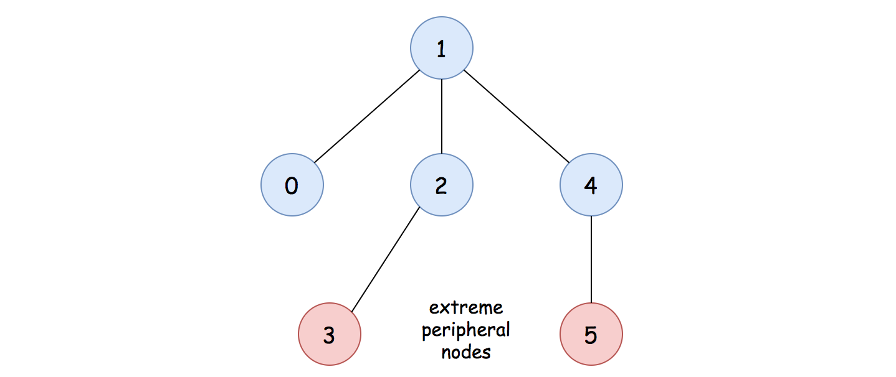
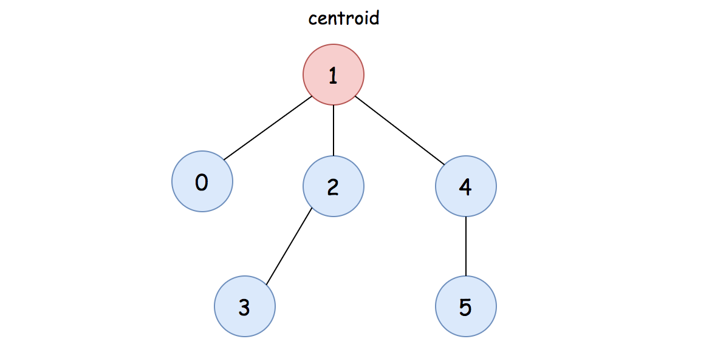
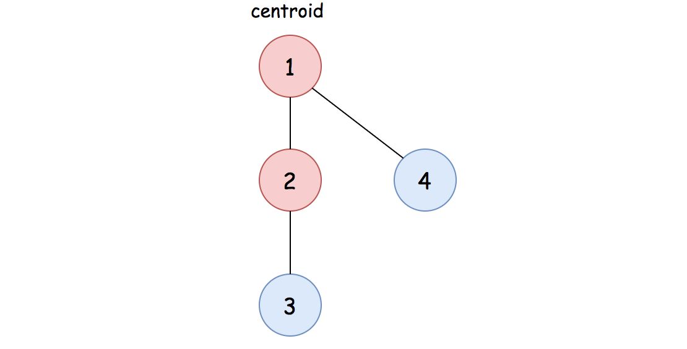
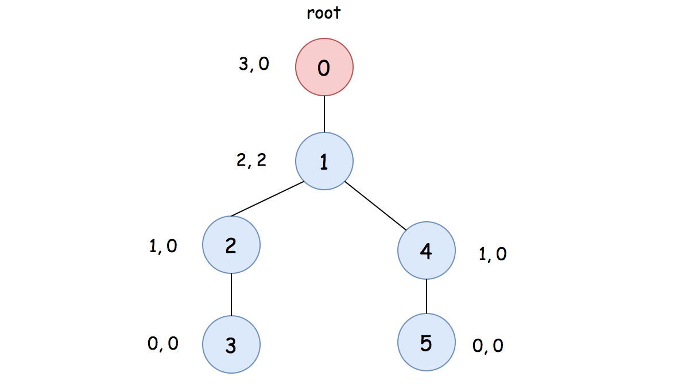

## Detailed Notes on BFS and DFS Approaches

## Overview

The **diameter of a tree** is the number of edges in the longest path between any two nodes.

We are given an undirected tree with:

- `n` nodes labeled from `0` to `n - 1`
- `n - 1` edges

Because the graph is guaranteed to be a tree:

- it is connected
- it has no cycles

This write-up explains three approaches:

1. **BFS twice to find the farthest nodes**
2. **BFS from the outside inward using centroids / leaf trimming**
3. **DFS to compute the longest downward paths through each node**

All three run in linear time.

---

# Key Property of Trees

A tree has exactly one simple path between any two nodes.

That is why the diameter is well-defined and easier to reason about than in a general graph.

The problem asks us for the length of the longest such path.

---

# Approach 1: Farthest Nodes via BFS

## Intuition

A classic property of trees is:

> If you start from any node and run BFS, one of the farthest nodes you reach is an endpoint of the diameter.

Then, if you start another BFS from that endpoint:

> the farthest node found in the second BFS is the other endpoint of the diameter

and the distance between them is the diameter.

This gives a very elegant two-pass algorithm.



---

## Why This Works

Suppose the true diameter endpoints are `A` and `B`.

If we start BFS from any arbitrary node `X`, then one of the nodes farthest from `X` must lie on an extreme end of the tree.
Intuitively, the farthest reachable point from any starting position gets “pulled” toward the boundary of the tree.

In a tree, the most distant boundary points are exactly diameter endpoints.

So the first BFS finds one endpoint of the diameter.
The second BFS, starting from that endpoint, finds the other endpoint and the diameter length.

---

## Algorithm

1. Build the adjacency list of the tree.
2. Run BFS starting from any node, say node `0`.
3. Let the farthest node found be `u`.
4. Run BFS again starting from `u`.
5. The farthest distance found in this second BFS is the diameter.

---

## Java Code

```java
class Solution {

    public int treeDiameter(int[][] edges) {

        List<Set<Integer>> graph = new ArrayList<Set<Integer>>();
        for (int i = 0; i < edges.length + 1; ++i) {
            graph.add(new HashSet<Integer>());
        }

        for (int[] edge : edges) {
            Integer u = edge[0], v = edge[1];
            graph.get(u).add(v);
            graph.get(v).add(u);
        }

        // 1). find one of the farthest nodes
        // farthest_node, distance_1 = bfs(0)
        int[] nodeDistance = bfs(0, graph);
        // 2). find the other farthest node
        // and the distance between two farthest nodes
        // another_farthest_node, distance_2 = bfs(farthest_node)
        nodeDistance = bfs(nodeDistance[0], graph);

        return nodeDistance[1];
    }

    /**
     * return the farthest node from the 'start' node and the distance between them.
     */
    private int[] bfs(int start, List<Set<Integer>> graph) {
        boolean[] visited = new boolean[graph.size()];
        visited[start] = true;

        LinkedList<Integer> queue = new LinkedList<Integer>();
        queue.addLast(start);
        Integer lastNode = start, distance = -1;

        while (queue.size() > 0) {
            LinkedList<Integer> nextQueue = new LinkedList<Integer>();

            while (queue.size() > 0) {
                int nextNode = queue.removeFirst();
                for (Integer neighbor : graph.get(nextNode)) {
                    if (!visited[neighbor]) {
                        visited[neighbor] = true;
                        nextQueue.addLast(neighbor);
                        lastNode = neighbor;
                    }
                }
            }
            // increase the distance for each level of BFS traversal.
            distance += 1;
            queue = nextQueue;
        }

        return new int[] {lastNode, distance};
    }

}
```

---

## Detailed Walkthrough

### Step 1: Build the graph

```java
List<Set<Integer>> graph = new ArrayList<Set<Integer>>();
for (int i = 0; i < edges.length + 1; ++i) {
    graph.add(new HashSet<Integer>());
}
for (int[] edge : edges) {
    Integer u = edge[0], v = edge[1];
    graph.get(u).add(v);
    graph.get(v).add(u);
}
```

Because the tree is undirected, every edge is added in both directions.

---

### Step 2: First BFS

```java
int[] nodeDistance = bfs(0, graph);
```

This finds a farthest node from node `0`.

The returned array contains:

- `nodeDistance[0]` = farthest node
- `nodeDistance[1]` = distance to that node

---

### Step 3: Second BFS

```java
nodeDistance = bfs(nodeDistance[0], graph);
```

Now start BFS from the farthest node found above.
The returned distance is the diameter.

---

### How `bfs(...)` works

The helper uses level-order traversal.

```java
Integer lastNode = start, distance = -1;
```

The `distance` starts at `-1` because it is incremented once per BFS layer, including the starting layer.

At each round:

- process the current layer
- build `nextQueue` for the next layer
- increment the distance

The final `lastNode` reached is one of the farthest nodes.

---

## Complexity Analysis

Let `N` be the number of nodes.

Since this is a tree, the number of edges is `N - 1`.

### Time Complexity

```text
O(N)
```

Why?

- building the graph takes `O(N)`
- each BFS visits every node once, so `O(N)`
- we run BFS twice, so still `O(N)`

---

### Space Complexity

```text
O(N)
```

Why?

- adjacency list uses `O(N)`
- visited array uses `O(N)`
- queue may hold up to `O(N)` nodes

---

# Approach 2: Centroids of Graph via BFS / Leaf Trimming

## Intuition

Another way to think about diameter uses the concept of **centroids** or the “center” of the tree.

If you repeatedly remove all leaf nodes layer by layer, eventually you reach the center of the tree.

A tree has either:

- **one centroid**, or
- **two centroids**

These centroids lie in the middle of the diameter.

That means:

- if there is one centroid, diameter = `2 * layers`
- if there are two centroids, diameter = `2 * layers + 1`

where `layers` is the number of rounds of leaf trimming required to reach the center.

This process is very similar to topological peeling.





---

## Why This Works

The leaves are the outermost nodes of the tree.

If we remove them all at once, then the next outermost layer becomes the new set of leaves.

Repeating this process peels the tree inward like an onion.

Eventually:

- if one node remains, that node is the single centroid
- if two nodes remain, those two are the double centroids

The number of peeling rounds gives the distance from the outside to the center, which directly determines the diameter.

---

## Algorithm

1. Build the adjacency list.
2. Find all current leaves (nodes with degree 1).
3. Repeatedly remove all leaves layer by layer.
4. Count how many layers are removed.
5. When at most two nodes remain:
   - if one node remains, diameter = `2 * layers`
   - if two nodes remain, diameter = `2 * layers + 1`

---

## Java Code

```java
class Solution {

    public int treeDiameter(int[][] edges) {

        // build the adjacency list representation of the graph.
        List<Set<Integer>> graph = new ArrayList<Set<Integer>>();
        for (int i = 0; i < edges.length + 1; ++i) {
            graph.add(new HashSet<Integer>());
        }
        for (int[] edge : edges) {
            Integer u = edge[0], v = edge[1];
            graph.get(u).add(v);
            graph.get(v).add(u);
        }

        // find the outer most nodes, i.e. leaf nodes
        LinkedList<Integer> leaves = new LinkedList<Integer>();
        for (int vertex = 0; vertex < graph.size(); ++vertex) {
            if (graph.get(vertex).size() == 1)
                leaves.add(vertex);
        }

        // "peel" the graph layer by layer,
        // until we have the centroids left.
        int layers = 0;
        int vertexLeft = edges.length + 1;
        while (vertexLeft > 2) {
            vertexLeft -= leaves.size();

            LinkedList<Integer> nextLeaves = new LinkedList<Integer>();

            for (int leaf : leaves) {
                // the only neighbor left on the leaf node.
                int neighbor = graph.get(leaf).iterator().next();
                graph.get(neighbor).remove(leaf);
                if (graph.get(neighbor).size() == 1)
                    nextLeaves.add(neighbor);
            }

            layers += 1;
            leaves = nextLeaves;
        }

        if (vertexLeft == 1)
            return layers * 2;
        else
            return layers * 2 + 1;
    }
}
```

---

## Detailed Walkthrough

### Step 1: Build adjacency sets

Sets are convenient here because we need to remove leaf edges dynamically.

```java
graph.get(neighbor).remove(leaf);
```

That is why `Set<Integer>` is used instead of a simple list.

---

### Step 2: Find initial leaves

```java
for (int vertex = 0; vertex < graph.size(); ++vertex) {
    if (graph.get(vertex).size() == 1)
        leaves.add(vertex);
}
```

A leaf in a tree is a node with exactly one neighbor.

---

### Step 3: Peel the tree

```java
while (vertexLeft > 2) {
    vertexLeft -= leaves.size();
    ...
    layers += 1;
    leaves = nextLeaves;
}
```

Each iteration removes one outer layer of leaves.

---

### Step 4: Update neighbors

```java
int neighbor = graph.get(leaf).iterator().next();
graph.get(neighbor).remove(leaf);
if (graph.get(neighbor).size() == 1)
    nextLeaves.add(neighbor);
```

Once a leaf is removed, its neighbor may become a new leaf.

---

### Step 5: Compute diameter from remaining centroids

```java
if (vertexLeft == 1)
    return layers * 2;
else
    return layers * 2 + 1;
```

This matches the geometric structure of the tree:

- one centroid → symmetric diameter
- two centroids → center lies on an edge, so add 1

---

## Complexity Analysis

### Time Complexity

```text
O(N)
```

Why?

- building the graph takes `O(N)`
- every node is removed exactly once
- every edge is processed a constant number of times

---

### Space Complexity

```text
O(N)
```

Why?

- adjacency sets use `O(N)`
- queues of leaves use `O(N)`

---

# Approach 3: DFS (Depth-First Search)

## Intuition

A diameter path may pass through any node in the tree.

For any node, if we know the two longest downward distances from that node to any leaves in its subtrees, then:

> the longest path passing through that node = `topDistance1 + topDistance2`

So if we compute this value for every node, the maximum over all nodes is the diameter.

This is a classic DFS tree-dp style approach.



---

## Key Idea

For each node:

- compute the longest downward distance to a leaf
- while doing so, track the two largest such distances from its children

If the two longest downward paths from a node are:

- `t1`
- `t2`

then the best diameter candidate passing through that node is:

```text
t1 + t2
```

The global diameter is the maximum of this over all nodes.

---

## Algorithm

1. Build the adjacency list.
2. Treat node `0` as an arbitrary root.
3. Run DFS.
4. At each node:
   - compute the top two child distances
   - update global diameter using their sum
   - return the maximum single downward distance to parent

---

## Java Code

```java
class Solution {
    private List<List<Integer>> graph;
    private Integer diameter = 0;

    public int treeDiameter(int[][] edges) {

        // build the adjacency list representation of the graph.
        this.graph = new ArrayList<List<Integer>>();
        boolean[] visited = new boolean[edges.length + 1];
        for (int i = 0; i < edges.length + 1; ++i) {
            this.graph.add(new ArrayList<Integer>());
            visited[i] = false;
        }
        for (int[] edge : edges) {
            Integer u = edge[0], v = edge[1];
            this.graph.get(u).add(v);
            this.graph.get(v).add(u);
        }

        dfs(0, visited);

        return this.diameter;
    }

    /**
     * return the max distance
     *   starting from the 'curr' node to its the leaf nodes
     */
    private int dfs(int curr, boolean[] visited) {
        // the top 2 distance starting from this node
        Integer topDistance1 = 0, topDistance2 = 0;

        visited[curr] = true;
        for (Integer neighbor : graph.get(curr)) {
            int distance = 0;
            if (!visited[neighbor])
                distance = 1 + this.dfs(neighbor, visited);

            if (distance > topDistance1) {
                topDistance2 = topDistance1;
                topDistance1 = distance;
            } else if (distance > topDistance2) {
                topDistance2 = distance;
            }
        }

        // with the top 2 distance, we can update the current diameter
        this.diameter = Math.max(this.diameter, topDistance1 + topDistance2);

        return topDistance1;
    }
}
```

---

## Detailed Walkthrough

### Step 1: Build adjacency list

```java
this.graph = new ArrayList<List<Integer>>();
...
for (int[] edge : edges) {
    Integer u = edge[0], v = edge[1];
    this.graph.get(u).add(v);
    this.graph.get(v).add(u);
}
```

Again, the tree is undirected, so each edge is added both ways.

---

### Step 2: DFS from node 0

```java
dfs(0, visited);
```

Any node can be chosen as the DFS root because the tree is connected and acyclic.

---

### Step 3: Compute child distances

For each neighbor, if not visited:

```java
distance = 1 + this.dfs(neighbor, visited);
```

This gives the length of the longest downward path from the current node through that child.

---

### Step 4: Track top two longest distances

```java
if (distance > topDistance1) {
    topDistance2 = topDistance1;
    topDistance1 = distance;
} else if (distance > topDistance2) {
    topDistance2 = distance;
}
```

We only need the best two, because the longest path through the node can use at most two branches.

---

### Step 5: Update diameter

```java
this.diameter = Math.max(this.diameter, topDistance1 + topDistance2);
```

This is the crucial step.

The best path through the current node is formed by combining its two deepest child paths.

---

### Step 6: Return one best downward distance

```java
return topDistance1;
```

To the parent, only one downward branch can be extended upward, so we return only the best one.

---

## Complexity Analysis

### Time Complexity

```text
O(N)
```

Why?

- building the graph takes `O(N)`
- DFS visits each node once
- each edge is processed a constant number of times

---

### Space Complexity

```text
O(N)
```

Why?

- adjacency list uses `O(N)`
- visited array uses `O(N)`
- recursion stack can be `O(N)` in the worst case (a chain-shaped tree)

---

# Comparing the Three Approaches

## Approach 1: BFS Twice

### Idea

Find one diameter endpoint using BFS, then BFS again from that endpoint.

### Strengths

- very elegant
- based on a beautiful tree property
- simple to reason about

### Time

```text
O(N)
```

### Space

```text
O(N)
```

---

## Approach 2: Centroid / Leaf Trimming

### Idea

Peel the tree inward layer by layer until reaching the centroid(s).

### Strengths

- closely connected to the “Minimum Height Trees” idea
- gives another structural perspective on diameter

### Time

```text
O(N)
```

### Space

```text
O(N)
```

---

## Approach 3: DFS

### Idea

For each node, combine the two deepest downward paths through its children.

### Strengths

- classic tree DP pattern
- useful for many diameter-style problems
- extends naturally to N-ary tree diameter variants

### Time

```text
O(N)
```

### Space

```text
O(N)
```

---

# Which Approach Should You Prefer?

## For simplicity and elegance

Use **Approach 1 (BFS twice)**.

It is the most well-known property-based solution.

## For tree-DP understanding

Use **Approach 3 (DFS)**.

It is especially useful if you want to generalize to other tree diameter problems.

## For structural insight

Use **Approach 2 (centroid peeling)**.

It gives a nice geometric interpretation of the tree.

---

# Final Takeaway

This problem has multiple elegant linear-time solutions because trees are highly structured.

The three most important insights are:

1. **BFS twice** finds diameter endpoints
2. **Peeling leaves** exposes the tree center, which determines the diameter
3. **DFS with two best child depths** computes the best path through every node

All of them run in `O(N)` time and `O(N)` space.

---

# Summary

## Problem

Return the diameter of an undirected tree, i.e. the number of edges in the longest path.

## Approach 1: BFS Twice

- BFS from any node to find one farthest endpoint
- BFS again from that endpoint
- returned distance is the diameter
- **Time:** `O(N)`
- **Space:** `O(N)`

## Approach 2: Centroid / Leaf Trimming

- repeatedly remove all leaves layer by layer
- derive diameter from number of layers and number of remaining centroids
- **Time:** `O(N)`
- **Space:** `O(N)`

## Approach 3: DFS

- for each node, track two longest downward distances
- diameter candidate through node = sum of top two distances
- **Time:** `O(N)`
- **Space:** `O(N)`

## Recommended

- **Approach 1** for the cleanest property-based solution
- **Approach 3** for the strongest tree-DP intuition
