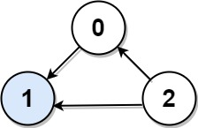
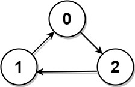

# 277. Find the Celebrity

## Problem Description

Suppose you are at a party with **n people** labeled from **0 to n - 1**. Among them, there **may exist a celebrity**.

A **celebrity** is defined as a person who:

- **Everyone else knows**, and
- **Does not know anyone else**

Formally:

- For celebrity `C`:
  - For every `i != C`, `knows(i, C) == true`
  - For every `i != C`, `knows(C, i) == false`

---

## Allowed Operation

You are **not allowed to directly access the relationship matrix**.

Instead, you can only ask questions using the helper function:

```java
boolean knows(int a, int b)
```

This returns:

- `true` if person `a` knows person `b`
- `false` otherwise

Your task is to **determine who the celebrity is** using the **minimum number of calls to `knows`**.

---

## Function to Implement

```java
int findCelebrity(int n)
```

Return:

- the **celebrity’s label** if one exists
- `-1` if there is **no celebrity**

---

## Input Representation (Conceptual Only)

Internally, the relationships can be imagined as an `n x n` matrix called `graph`:

```
graph[i][j] = 1  → person i knows person j
graph[i][j] = 0  → person i does not know person j
```

Important:

```
graph[i][i] == 1
```

However, this matrix is **not directly accessible**. Only the `knows(a,b)` API can be used.

---

# Example 1



## Input

```
graph = [
 [1,1,0],
 [0,1,0],
 [1,1,1]
]
```

## Output

```
1
```

## Explanation

There are **three people**:

```
0, 1, 2
```

Check person `1`:

- `0` knows `1`
- `2` knows `1`
- `1` knows **nobody else**

Therefore **1 is the celebrity**.

---

# Example 2



## Input

```
graph = [
 [1,0,1],
 [1,1,0],
 [0,1,1]
]
```

## Output

```
-1
```

## Explanation

There is **no person** who satisfies:

```
everyone knows them AND they know nobody
```

Therefore there is **no celebrity**.

---

# Constraints

```
2 <= n <= 100
graph.length == n
graph[i].length == n
graph[i][j] ∈ {0,1}
graph[i][i] == 1
```

---

# Follow-Up

If the **maximum number of allowed calls to `knows` is `3 * n`**, can you design an algorithm that **does not exceed this limit**?
