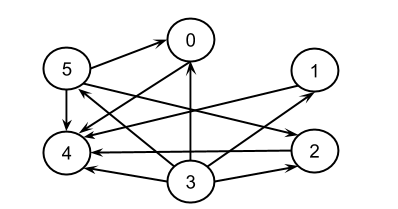
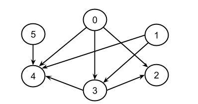
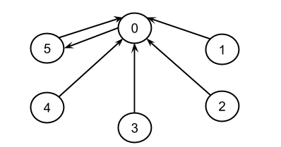
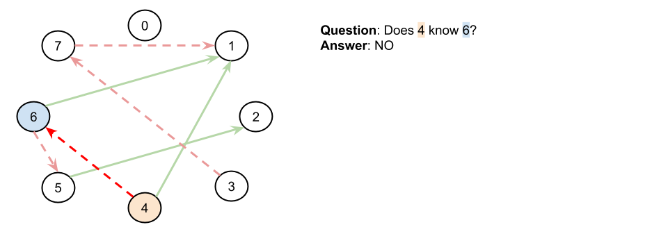
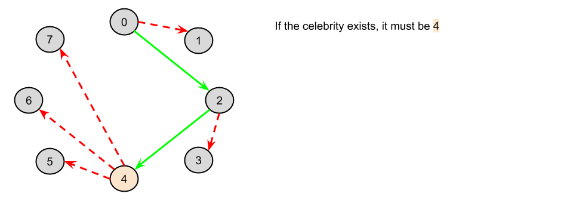
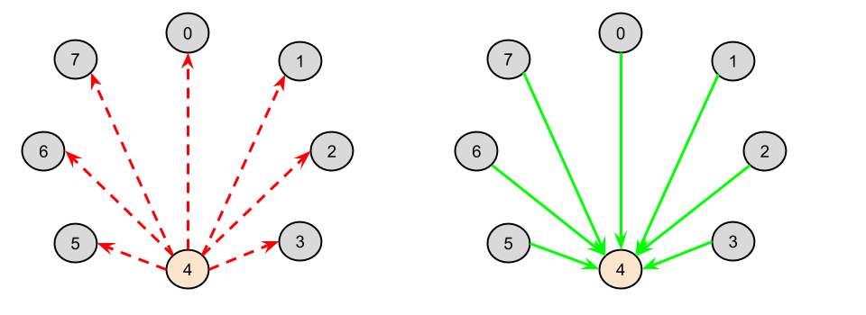

# 277. Find the Celebrity

## Detailed Notes on Brute Force, Logical Deduction, and Caching

## Overview

We are given `n` people labeled from `0` to `n - 1`.

A **celebrity** is defined as someone such that:

- everyone else knows them
- they know nobody else

We cannot directly inspect the full relationship matrix.
Instead, we can only ask questions through the API:

```java
boolean knows(int a, int b)
```

which tells us whether person `a` knows person `b`.

Our goal is to identify the celebrity, or determine that there is none, while using as few API calls as possible.

This write-up explains three approaches:

1. **Brute Force**
2. **Logical Deduction**
3. **Logical Deduction with Caching**

---

# Graph Interpretation of the Problem

A very useful way to think about this problem is as a **directed graph**.

- each person is a node
- a directed edge from `A` to `B` means:
  ```text
  A knows B
  ```

In this graph, a celebrity must have:

- **outdegree = 0**
- **indegree = n - 1**

That means:

- there are no outgoing edges from the celebrity
- there are incoming edges from every other person

This graph viewpoint makes the deduction approach much easier to understand.

---

# What We Need to Verify for a Person `i`

To confirm that person `i` is a celebrity, two conditions must hold for every other person `j`:

1. `i` does **not** know `j`
2. `j` **does** know `i`

So for each `j != i`, we need to verify:

```java
!knows(i, j) && knows(j, i)
```

This is the basic check behind all approaches.

---

# Approach 1: Brute Force

## Intuition

The most direct way to solve the problem is:

- check each person one by one
- ask whether they satisfy the celebrity conditions
- if yes, return them
- if no one satisfies them, return `-1`

This is straightforward and easy to implement.

---

## Why It Works

If there is a celebrity, then checking every person in turn will eventually find them.

If there is no celebrity, all candidates will fail the test and we return `-1`.

So correctness is immediate.

---

## Helper Function `isCelebrity(i)`

It is best to define a separate helper:

```java
isCelebrity(i)
```

This function checks whether person `i` is a celebrity.

For every other person `j`:

- if `i` knows `j`, then `i` cannot be a celebrity
- if `j` does not know `i`, then `i` cannot be a celebrity

If neither problem occurs for any `j`, then `i` is a celebrity.

---

## Important Edge Case

We should not ask:

```java
knows(i, i)
```

because whether someone knows themselves is irrelevant.

So in the loop we skip:

```java
if (i == j) continue;
```

---

## Java Code

```java
public class Solution extends Relation {

    private int numberOfPeople;

    public int findCelebrity(int n) {
        numberOfPeople = n;
        for (int i = 0; i < n; i++) {
            if (isCelebrity(i)) {
                return i;
            }
        }
        return -1;
    }

    private boolean isCelebrity(int i) {
        for (int j = 0; j < numberOfPeople; j++) {
            if (i == j) continue; // Don't ask if they know themselves.
            if (knows(i, j) || !knows(j, i)) {
                return false;
            }
        }
        return true;
    }
}
```

---

## Detailed Walkthrough

### Step 1: Try every person

```java
for (int i = 0; i < n; i++) {
    if (isCelebrity(i)) {
        return i;
    }
}
```

Each person is treated as a candidate.

---

### Step 2: Verify candidate

```java
if (knows(i, j) || !knows(j, i)) {
    return false;
}
```

This is the exact celebrity test:

- if candidate knows anyone → fail
- if someone does not know candidate → fail

---

### Step 3: Return `-1` if nobody passes

```java
return -1;
```

---

## Complexity Analysis

Assume each `knows(...)` call is `O(1)`.

### Time Complexity

```text
O(n^2)
```

Why?

- there are `n` candidates
- each candidate requires checking all other `n - 1` people
- each check makes up to 2 API calls

So total work is quadratic.

---

### Space Complexity

```text
O(1)
```

We only use a few variables and do not store extra data proportional to `n`.

---

## Pros and Cons

### Pros

- simple
- easy to understand
- direct correctness argument

### Cons

- too many API calls
- misses the logical structure of the problem

This motivates a better approach.

---

# Approach 2: Logical Deduction

## Intuition







We can do much better than brute force.

The crucial observation is this:

> A single call to `knows(A, B)` lets us eliminate exactly one of `A` or `B` from celebrity consideration.

Why?

### If `knows(A, B)` is `true`

Then `A` cannot be a celebrity, because celebrities know nobody.

### If `knows(A, B)` is `false`

Then `B` cannot be a celebrity, because celebrities must be known by everyone, and here `A` does not know `B`.

So each query rules out one person.

This means we can narrow the field down to **one possible celebrity** in linear time.



---

# Candidate Elimination Strategy

Start with:

```java
celebrityCandidate = 0
```

Then for each `i` from `1` to `n - 1`:

- ask:
  ```java
  knows(celebrityCandidate, i)
  ```
- if `true`, the current candidate is impossible, so replace them with `i`
- if `false`, then `i` is impossible, so keep the current candidate

At the end, only one person remains not ruled out.

That person is the **only possible celebrity**.

But they are not guaranteed to actually be a celebrity yet.
We still need to verify them with the full `isCelebrity(...)` check.



---

## Why the Deduction Works

Suppose current candidate is `c`.

When comparing `c` with `i`:

### Case 1: `knows(c, i)` is true

Then `c` is not a celebrity.
So `i` becomes the new possible candidate.

### Case 2: `knows(c, i)` is false

Then `i` is not a celebrity.
So keep `c`.

Thus after each comparison, one person is eliminated.

After `n - 1` comparisons, exactly one possible celebrity remains.

---

## Java Code

```java
public class Solution extends Relation {

    private int numberOfPeople;

    public int findCelebrity(int n) {
        numberOfPeople = n;
        int celebrityCandidate = 0;
        for (int i = 0; i < n; i++) {
            if (knows(celebrityCandidate, i)) {
                celebrityCandidate = i;
            }
        }
        if (isCelebrity(celebrityCandidate)) {
            return celebrityCandidate;
        }
        return -1;
    }

    private boolean isCelebrity(int i) {
        for (int j = 0; j < numberOfPeople; j++) {
            if (i == j) continue; // Don't ask if they know themselves.
            if (knows(i, j) || !knows(j, i)) {
                return false;
            }
        }
        return true;
    }
}
```

---

## Detailed Walkthrough

### Phase 1: Find the only possible candidate

```java
int celebrityCandidate = 0;
for (int i = 0; i < n; i++) {
    if (knows(celebrityCandidate, i)) {
        celebrityCandidate = i;
    }
}
```

This phase is just elimination.

After it finishes, every person except `celebrityCandidate` has been ruled out.

---

### Phase 2: Verify the candidate

```java
if (isCelebrity(celebrityCandidate)) {
    return celebrityCandidate;
}
return -1;
```

The candidate could still fail because:

- someone might not know them
- or they might know someone not tested in the elimination logic

So verification is required.

---

# Example of the Deduction

Suppose we compare people in order:

- candidate vs 1
- candidate vs 2
- candidate vs 3
- ...

At every step, one person gets ruled out.

By the end, only one candidate survives.

This is why the first phase is only `O(n)`.

---

## Complexity Analysis

### Time Complexity

```text
O(n)
```

Why?

There are two phases:

#### Phase 1: Candidate elimination

- makes `n - 1` calls to `knows`
- costs `O(n)`

#### Phase 2: Candidate verification

- checks all other people
- costs `O(n)`

Total:

```text
O(n) + O(n) = O(n)
```

---

### Space Complexity

```text
O(1)
```

Only constant extra variables are used.

---

## Why This Meets the Follow-Up

The follow-up asks whether we can stay within:

```text
3 * n
```

calls to `knows`.

This approach essentially does that.

- about `n - 1` calls in elimination
- at most `2(n - 1)` calls in verification

Total:

```text
3n - 3
```

which is within `3 * n`.

So this is the intended optimal asymptotic solution.

---

## Pros and Cons

### Pros

- optimal asymptotic complexity
- elegant logical deduction
- satisfies follow-up API limit

### Cons

- still repeats some `knows(...)` calls between elimination and verification

That leads to a caching variant.

---

# Approach 3: Logical Deduction with Caching

## Intuition

Approach 2 is already asymptotically optimal.

However, in practice, some `knows(...)` calls can be repeated.

This may not matter for big-O analysis, but if the API is expensive, avoiding duplicate calls could still be valuable.

For example:

- if the API is backed by a slow remote service
- or if each call represents an expensive real-world interaction

then reducing repeated calls improves actual runtime.

The tradeoff is extra memory.




---

# Idea of Caching

Store the result of each `knows(a, b)` call the first time it is asked.

Then if the same query is needed again, return the cached value instead of calling the API again.

This is exactly like memoization.

---

## Java Code

```java
public class Solution extends Relation {

    private int numberOfPeople;
    private Map<Pair<Integer, Integer>, Boolean> cache = new HashMap<>();

    @Override
    public boolean knows(int a, int b) {
        if (!cache.containsKey(new Pair(a, b))) {
            cache.put(new Pair(a, b), super.knows(a, b));
        }
        return cache.get(new Pair(a, b));
    }

    public int findCelebrity(int n) {
        numberOfPeople = n;
        int celebrityCandidate = 0;
        for (int i = 0; i < n; i++) {
            if (knows(celebrityCandidate, i)) {
                celebrityCandidate = i;
            }
        }
        if (isCelebrity(celebrityCandidate)) {
            return celebrityCandidate;
        }
        return -1;
    }

    private boolean isCelebrity(int i) {
        for (int j = 0; j < numberOfPeople; j++) {
            if (i == j) continue; // Don't ask if they know themselves.
            if (knows(i, j) || !knows(j, i)) {
                return false;
            }
        }
        return true;
    }
}
```

---

## Detailed Walkthrough

### Step 1: Override `knows`

```java
@Override
public boolean knows(int a, int b) {
    if (!cache.containsKey(new Pair(a, b))) {
        cache.put(new Pair(a, b), super.knows(a, b));
    }
    return cache.get(new Pair(a, b));
}
```

This wrapper ensures every pair `(a, b)` is asked at most once.

---

### Step 2: Use same candidate elimination and verification

The rest of the algorithm is identical to Approach 2.

The only difference is that repeated queries now become cheap cache lookups.

---

## Complexity Analysis

### Time Complexity

```text
O(n)
```

Asymptotically, the algorithm is still linear.

Caching reduces repeated constant-time API calls, but does not change the big-O time.

---

### Space Complexity

```text
O(n)
```

Why?

The cached calls made during elimination can be up to linear in number.

So we now trade memory for fewer repeated API calls.

---

## Is This Worth It?

From a pure asymptotic interview perspective, usually not necessary.

Approach 2 is already optimal.

But as a practical systems idea, it can be valuable if:

- `knows` is slow
- repeated calls are expensive
- runtime constants matter

So this is a nice follow-up discussion point.

---

# Comparing the Approaches

## Approach 1: Brute Force

### Idea

Try every person and verify them fully.

### Time

```text
O(n^2)
```

### Space

```text
O(1)
```

### Best For

Initial straightforward solution.

### Main Weakness

Too many API calls.

---

## Approach 2: Logical Deduction

### Idea

Use each `knows(a, b)` query to eliminate one person from celebrity consideration, then verify the final candidate.

### Time

```text
O(n)
```

### Space

```text
O(1)
```

### Best For

Optimal interview solution.

### Main Strength

Satisfies the follow-up limit.

---

## Approach 3: Logical Deduction with Caching

### Idea

Same as Approach 2, but memoize `knows(a, b)` results to avoid duplicate calls.

### Time

```text
O(n)
```

### Space

```text
O(n)
```

### Best For

Reducing repeated expensive API calls in practice.

---

# Which Approach Should You Prefer?

Use **Approach 2**.

It is the cleanest and most important solution:

- optimal asymptotic complexity
- elegant logical reasoning
- fits the follow-up requirement

Approach 1 is useful as a baseline.
Approach 3 is useful as an optimization discussion.

---

# Final Takeaway

The critical observation in this problem is:

> A single `knows(A, B)` query always eliminates exactly one of `A` or `B` from being the celebrity.

That allows us to reduce the search space from `n` possible people down to one candidate in linear time.

After that, one final verification step confirms whether the candidate is truly a celebrity.

That gives the optimal `O(n)` solution.

---

# Summary

## Celebrity Definition

A celebrity is someone who:

- is known by everyone else
- knows nobody else

## Approach 1: Brute Force

- test every person with `isCelebrity`
- **Time:** `O(n^2)`
- **Space:** `O(1)`

## Approach 2: Logical Deduction

- eliminate one person per `knows(...)` query
- verify the final candidate
- **Time:** `O(n)`
- **Space:** `O(1)`

## Approach 3: Logical Deduction with Caching

- same as Approach 2
- cache repeated API calls
- **Time:** `O(n)`
- **Space:** `O(n)`

## Recommended

Use **Approach 2** for the standard optimal solution.
