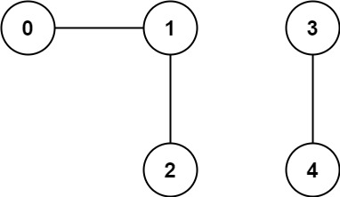
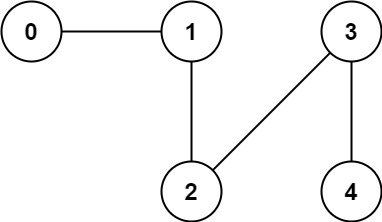

# 323. Number of Connected Components in an Undirected Graph

## Problem Description

You are given an **undirected graph** with `n` nodes labeled from:

```
0 to n - 1
```

The graph connections are represented by an array:

```
edges[i] = [ai, bi]
```

This means there is an **undirected edge** between node `ai` and node `bi`.

Your task is to determine **how many connected components** exist in the graph.

---

## What is a Connected Component?

A **connected component** is a group of nodes where:

- every node is reachable from every other node in the group
- there are no connections to nodes outside the group

Example:

```
0 --- 1 --- 2     3 --- 4
```

There are **2 connected components**:

```
{0,1,2}  and  {3,4}
```

---

# Example 1



## Input

```
n = 5
edges = [[0,1],[1,2],[3,4]]
```

## Graph Representation

```
0 --- 1 --- 2     3 --- 4
```

## Output

```
2
```

## Explanation

There are two separate groups:

```
Component 1: {0,1,2}
Component 2: {3,4}
```

So the answer is **2**.

---

# Example 2



## Input

```
n = 5
edges = [[0,1],[1,2],[2,3],[3,4]]
```

## Graph Representation

```
0 --- 1 --- 2 --- 3 --- 4
```

## Output

```
1
```

## Explanation

All nodes are connected together in a single component:

```
{0,1,2,3,4}
```

So the result is **1**.

---

# Constraints

```
1 <= n <= 2000
1 <= edges.length <= 5000
edges[i].length == 2
0 <= ai <= bi < n
ai != bi
```

Additional guarantees:

- The graph contains **no duplicate edges**
- Each edge connects **two distinct nodes**
