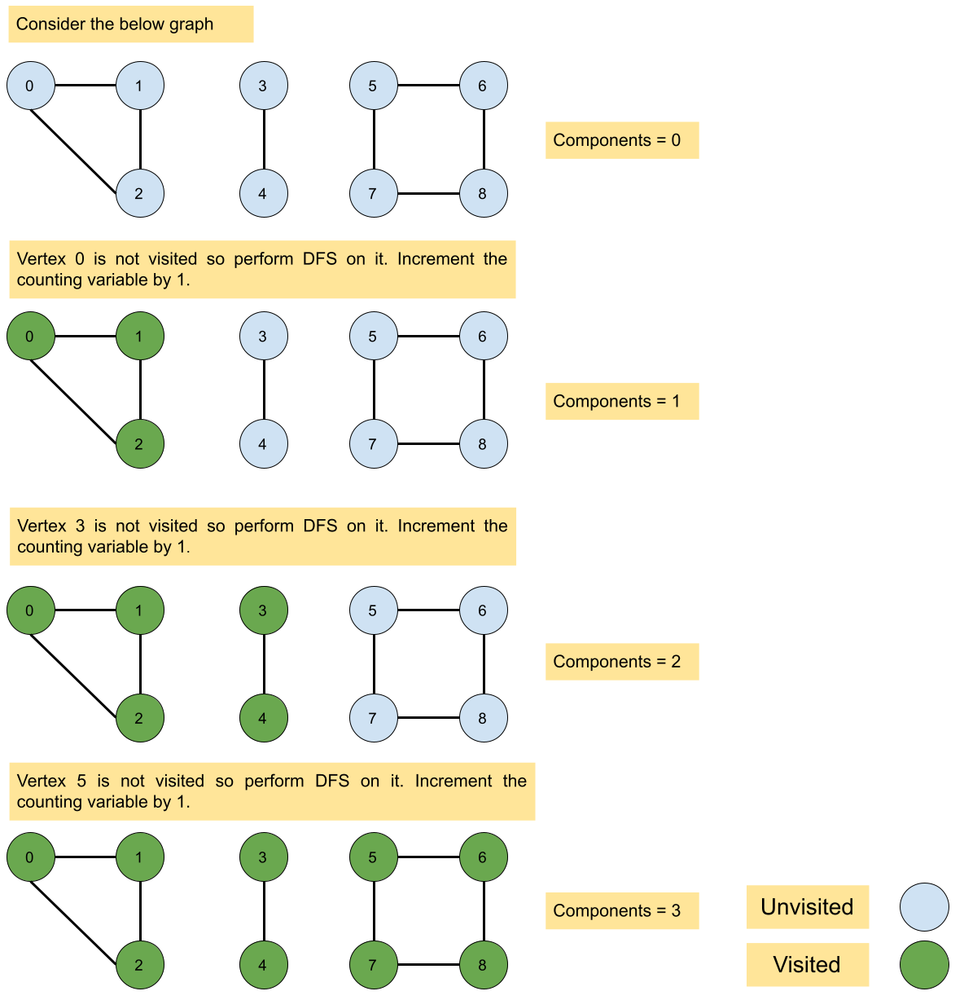
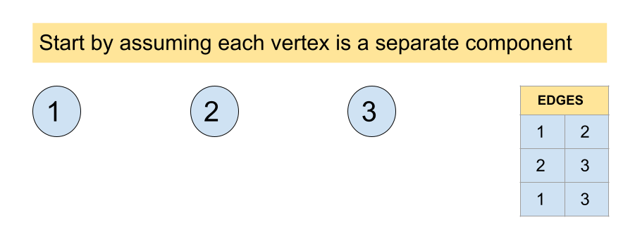
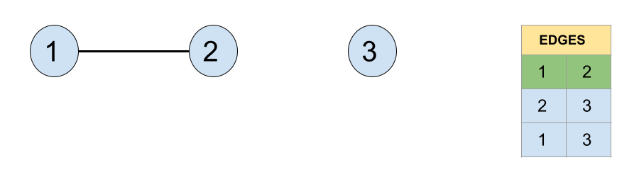
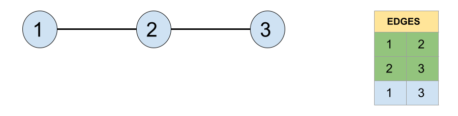
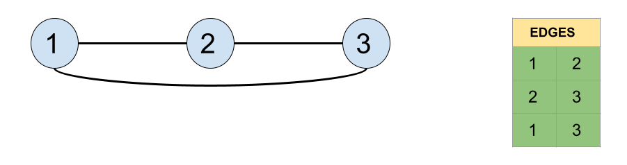

# 323. Number of Connected Components in an Undirected Graph

## Detailed Notes on DFS and Disjoint Set Union (DSU)

## Overview

We are given an undirected graph with:

- `n` vertices labeled from `0` to `n - 1`
- an edge list `edges`, where each edge connects two vertices

Our task is to return the number of **connected components** in the graph.

A connected component is a group of vertices such that every vertex in the group is reachable from every other vertex in that group.

This document explains two standard approaches in detail:

1. **Depth-First Search (DFS)**
2. **Disjoint Set Union (DSU) / Union-Find**

---

# What Is a Connected Component?

In an undirected graph, a connected component is a maximal set of vertices such that:

- every pair of vertices in the set has a path between them
- no extra outside vertex can be added while preserving that property

For example, in:

```text
0 -- 1 -- 2    3 -- 4
```

there are two connected components:

```text
{0,1,2} and {3,4}
```

So the essential problem is to identify how many separate “islands” of connectivity exist.

---

# Approach 1: Depth-First Search (DFS)

## Intuition

DFS is a natural fit for connected-component problems.

If we start DFS from a vertex:

- it visits that vertex
- then recursively explores all reachable neighbors
- and keeps going until there are no more reachable unvisited vertices

That means:

> A single DFS call visits exactly one connected component.

So the full strategy is:

- iterate over all vertices
- whenever we see an unvisited vertex, start a DFS from it
- that DFS marks all vertices in that component
- increment the component count

The number of times we have to start a new DFS is exactly the number of connected components.

---

## Why This Works

Suppose vertex `v` belongs to some connected component `C`.

When we run DFS starting from `v`, DFS will follow every reachable path and visit every vertex in `C`.

Because the graph is undirected and connected within that component, every vertex in `C` is reachable from `v`.

So after that DFS finishes:

- the whole component containing `v` is marked visited

Later, when the outer loop continues:

- every vertex from that component is skipped
- the next unvisited vertex must belong to a completely different component

So counting DFS launches gives the exact answer.



---

## Algorithm

1. Create an adjacency list `adjList` where `adjList[v]` contains all neighbors of vertex `v`.
2. Create a `visited` array to track whether each vertex has been explored.
3. Initialize a counter `components = 0`.
4. Iterate through every vertex from `0` to `n - 1`.
5. If the vertex is not visited:
   - increment `components`
   - start DFS from that vertex
6. DFS marks every vertex in that connected component as visited.
7. After the loop, return `components`.

---

## Java Code

```java
class Solution {

    private void dfs(List<Integer>[] adjList, int[] visited, int startNode) {
        visited[startNode] = 1;

        for (int i = 0; i < adjList[startNode].size(); i++) {
            if (visited[adjList[startNode].get(i)] == 0) {
                dfs(adjList, visited, adjList[startNode].get(i));
            }
        }
    }

    public int countComponents(int n, int[][] edges) {
        int components = 0;
        int[] visited = new int[n];

        List<Integer>[] adjList = new ArrayList[n];
        for (int i = 0; i < n; i++) {
            adjList[i] = new ArrayList<Integer>();
        }

        for (int i = 0; i < edges.length; i++) {
            adjList[edges[i][0]].add(edges[i][1]);
            adjList[edges[i][1]].add(edges[i][0]);
        }

        for (int i = 0; i < n; i++) {
            if (visited[i] == 0) {
                components++;
                dfs(adjList, visited, i);
            }
        }
        return components;
    }
}
```

---

## Detailed Walkthrough of the DFS Code

### 1. Build the visited array

```java
int[] visited = new int[n];
```

This keeps track of which vertices have already been explored.

- `0` means not visited
- `1` means visited

---

### 2. Build the adjacency list

```java
List<Integer>[] adjList = new ArrayList[n];
for (int i = 0; i < n; i++) {
    adjList[i] = new ArrayList<Integer>();
}
```

Each vertex gets its own list of neighbors.

Then fill it from the edge list:

```java
for (int i = 0; i < edges.length; i++) {
    adjList[edges[i][0]].add(edges[i][1]);
    adjList[edges[i][1]].add(edges[i][0]);
}
```

Because the graph is undirected, every edge goes into both directions.

---

### 3. DFS helper

```java
private void dfs(List<Integer>[] adjList, int[] visited, int startNode) {
    visited[startNode] = 1;

    for (int i = 0; i < adjList[startNode].size(); i++) {
        if (visited[adjList[startNode].get(i)] == 0) {
            dfs(adjList, visited, adjList[startNode].get(i));
        }
    }
}
```

This function:

- marks the current node as visited
- recursively visits all unvisited neighbors

So one DFS fully explores one component.

---

### 4. Count components

```java
for (int i = 0; i < n; i++) {
    if (visited[i] == 0) {
        components++;
        dfs(adjList, visited, i);
    }
}
```

This is the central counting idea.

Each time we find an unvisited node, it must belong to a brand new connected component.

So we:

- increment the count
- explore that full component

---

## Example Walkthrough

Suppose:

```text
n = 5
edges = [[0,1],[1,2],[3,4]]
```

Adjacency list:

```text
0 -> [1]
1 -> [0,2]
2 -> [1]
3 -> [4]
4 -> [3]
```

Now loop through vertices:

### i = 0

- not visited
- components = 1
- DFS from 0 visits: 0, 1, 2

### i = 1

- already visited, skip

### i = 2

- already visited, skip

### i = 3

- not visited
- components = 2
- DFS from 3 visits: 3, 4

### i = 4

- already visited, skip

Final answer:

```text
2
```

---

## Complexity Analysis

Let:

- `V` = number of vertices
- `E` = number of edges

### Time Complexity

```text
O(V + E)
```

Why?

#### Building the adjacency list

- initialize `V` lists → `O(V)`
- process each edge once and add it to two lists → `O(E)`

#### DFS traversal

- each vertex is visited exactly once → `O(V)`
- across all DFS calls, each adjacency list entry is examined once → `O(E)`

So total time:

```text
O(V + E)
```

---

### Space Complexity

```text
O(V + E)
```

Why?

- adjacency list uses `O(V + E)`
- visited array uses `O(V)`
- recursion stack can use up to `O(V)` in the worst case

So total auxiliary space is linear in graph size.

---

## Strengths and Weaknesses of DFS

### Strengths

- very intuitive
- directly matches the meaning of connected components
- standard graph traversal approach

### Weaknesses

- recursive implementation may risk stack overflow in deeper graphs
- requires building adjacency list

That leads naturally to the DSU approach.

---

# Approach 2: Disjoint Set Union (DSU)

## Intuition

Imagine starting with `n` isolated vertices and no edges.

Then the number of connected components is clearly:

```text
n
```

Now process edges one by one.

Each time an edge connects two vertices in **different components**, those two components merge into one.

That means the total number of connected components decreases by 1.

However, if an edge connects two vertices that are **already in the same component**, then the number of components does not change.

This is exactly what Disjoint Set Union is designed for.









---

# DSU Core Idea

DSU maintains groups of connected vertices.

It supports two key operations:

## 1. `find(x)`

Return the representative of the set containing `x`.

## 2. `union(x, y)`

Merge the sets containing `x` and `y`.

If `x` and `y` are already in the same set, nothing changes.

---

## Why DSU Solves This Problem

Initially:

- each vertex is its own connected component
- so `components = n`

For every edge `(u, v)`:

- if `u` and `v` are in different sets, union them and decrement components
- otherwise do nothing

At the end, `components` is the number of connected components in the graph.

---

## Java Code

```java
public class Solution {

    private int find(int[] representative, int vertex) {
        if (vertex == representative[vertex]) {
            return vertex;
        }

        return representative[vertex] = find(representative, representative[vertex]);
    }

    private int combine(int[] representative, int[] size, int vertex1, int vertex2) {
        vertex1 = find(representative, vertex1);
        vertex2 = find(representative, vertex2);

        if (vertex1 == vertex2) {
            return 0;
        } else {
            if (size[vertex1] > size[vertex2]) {
                size[vertex1] += size[vertex2];
                representative[vertex2] = vertex1;
            } else {
                size[vertex2] += size[vertex1];
                representative[vertex1] = vertex2;
            }
            return 1;
        }
    }

    public int countComponents(int n, int[][] edges) {
        int[] representative = new int[n];
        int[] size = new int[n];

        for (int i = 0; i < n; i++) {
            representative[i] = i;
            size[i] = 1;
        }

        int components = n;
        for (int i = 0; i < edges.length; i++) {
            components -= combine(representative, size, edges[i][0], edges[i][1]);
        }

        return components;
    }
}
```

---

## Detailed Walkthrough of the DSU Code

### 1. Initialize DSU arrays

```java
int[] representative = new int[n];
int[] size = new int[n];

for (int i = 0; i < n; i++) {
    representative[i] = i;
    size[i] = 1;
}
```

Initially:

- every node is its own parent
- each component has size 1

So there are `n` connected components at the start.

---

### 2. `find(...)` with path compression

```java
private int find(int[] representative, int vertex) {
    if (vertex == representative[vertex]) {
        return vertex;
    }

    return representative[vertex] = find(representative, representative[vertex]);
}
```

This function finds the root representative of the component containing `vertex`.

Path compression makes future queries faster by flattening the structure.

---

### 3. `combine(...)`

```java
private int combine(int[] representative, int[] size, int vertex1, int vertex2)
```

This function attempts to merge the components of the two endpoints.

#### If already in same component

```java
if (vertex1 == vertex2) {
    return 0;
}
```

No merge happens, so the component count should not change.

#### If in different components

Merge smaller component into larger one:

```java
if (size[vertex1] > size[vertex2]) {
    size[vertex1] += size[vertex2];
    representative[vertex2] = vertex1;
} else {
    size[vertex2] += size[vertex1];
    representative[vertex1] = vertex2;
}
return 1;
```

Returning `1` signals that a merge happened.

---

### 4. Count components

```java
int components = n;
for (int i = 0; i < edges.length; i++) {
    components -= combine(representative, size, edges[i][0], edges[i][1]);
}
```

If `combine(...)` returns `1`, the number of connected components decreases by one.

If it returns `0`, nothing changes.

---

## Example Walkthrough

Suppose:

```text
n = 5
edges = [[0,1],[1,2],[3,4]]
```

Initially:

```text
components = 5
```

### Process edge (0,1)

- different sets
- merge
- components = 4

### Process edge (1,2)

- different sets
- merge
- components = 3

### Process edge (3,4)

- different sets
- merge
- components = 2

Final answer:

```text
2
```

---

## Another Example Where an Edge Changes Nothing

Suppose we already connected:

```text
1 -- 2
2 -- 3
```

Then `1` and `3` are already in the same component.

If we add edge:

```text
1 -- 3
```

then DSU finds they already share the same representative.

So the number of components stays unchanged.

This is exactly the right behavior.

---

## Complexity Analysis

Let:

- `V` = number of vertices
- `E` = number of edges

### Time Complexity

```text
O(V + E * α(V))
```

Why?

- initializing DSU arrays takes `O(V)`
- each edge triggers one `combine(...)`
- `combine(...)` uses `find(...)`, which is amortized `O(α(V))`

Here `α(V)` is the inverse Ackermann function, which grows extremely slowly and is effectively constant in practice.

So this is very close to linear time.

---

### Space Complexity

```text
O(V)
```

Why?

We only store:

- `representative[]`
- `size[]`

each of size `V`.

No adjacency list is needed.

---

## Strengths and Weaknesses of DSU

### Strengths

- elegant for component counting
- does not require building adjacency list
- very efficient in practice
- excellent for dynamic connectivity problems

### Weaknesses

- less intuitive than DFS if you are new to Union-Find
- does not explicitly show component structure the way traversal does

---

# Comparing the Two Approaches

## Approach 1: DFS

### Idea

Start DFS from every unvisited vertex. Each DFS visits exactly one connected component.

### Time

```text
O(V + E)
```

### Space

```text
O(V + E)
```

### Best For

- directly understanding connected components
- classic graph traversal problems

---

## Approach 2: DSU

### Idea

Start with `n` components and merge them as edges are processed.

### Time

```text
O(V + E * α(V))
```

### Space

```text
O(V)
```

### Best For

- problems involving repeated unions
- connectivity counting without traversal
- very practical optimized solution

---

# Which Approach Should You Prefer?

## For conceptual clarity

Use **DFS**.

It directly matches the idea of a connected component as a set of reachable vertices.

## For a cleaner component-counting data structure

Use **DSU**.

It is especially strong if you already know Union-Find well.

In interviews, both are good.
DFS is often easier to explain first.
DSU can be a strong follow-up or primary solution if the interviewer expects it.

---

# Final Takeaway

There are two natural ways to count connected components:

1. **Traversal viewpoint**
   A connected component is everything reachable from one starting node.
   So count how many DFS launches are needed.

2. **Set-merging viewpoint**
   Initially every node is separate.
   Each edge may merge two components.
   So track the number of successful unions.

Both ideas are correct and efficient.

---

# Summary

## Problem

Return the number of connected components in an undirected graph.

## Approach 1: DFS

- build adjacency list
- run DFS from every unvisited node
- increment count for each new DFS
- **Time:** `O(V + E)`
- **Space:** `O(V + E)`

## Approach 2: DSU

- initialize `components = n`
- for every edge, union endpoints
- decrement components only when a real merge happens
- **Time:** `O(V + E * α(V))`
- **Space:** `O(V)`

## Recommended

- Use **DFS** for the clearest graph-traversal solution
- Use **DSU** for an elegant connectivity-merging solution
