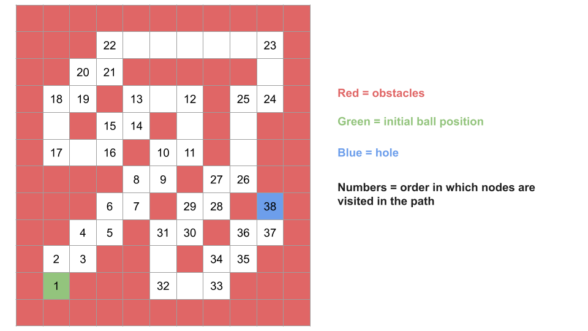

# The Maze III

## Detailed Notes on Dijkstra's Algorithm Approach

## Overview

This problem is the third installment in **The Maze** series.

The maze can be viewed as a graph:

- each open square is a node
- from any node, the ball can roll in one of the four directions
- the ball keeps rolling until it hits a wall or falls into the hole
- the distance of an edge is the number of squares rolled

We are asked to find:

1. the **shortest distance** from the ball to the hole
2. and among all shortest paths, the **lexicographically smallest instruction string**

Because the edge costs are not uniform, this is a **weighted shortest path** problem.
That makes **Dijkstra’s algorithm** the natural solution.

---

# Why BFS Is Not Enough

A standard BFS works when all edges have equal weight.

That is not true here.

In this maze:

- one move might roll the ball by `1` square
- another move might roll it by `20` squares

Even though both are single “decisions,” they do not cost the same distance.

So the graph is weighted, and BFS would not correctly guarantee the shortest total distance.

That is why we use **Dijkstra’s algorithm**, which is designed for shortest paths in graphs with non-negative weights.

---

# Core Graph Interpretation

We treat the maze as a graph where:

- each empty square is a node
- from a node, neighbors are the positions where the ball stops after rolling in each of the four directions
- the edge weight is the number of steps rolled before stopping or falling into the hole

This graph is not given explicitly.
We generate neighbors on demand by simulating the rolling.

---

# Additional Twist: Lexicographically Smallest Path

The problem does not ask only for the minimum distance.

If there are multiple shortest paths, we must return the one whose path string is lexicographically smallest.

So each state in Dijkstra’s algorithm must track both:

- current total distance
- current path string

And the priority queue must order states by:

1. smaller distance first
2. if distances tie, smaller path string first

That is the key modification from ordinary Dijkstra.

---

# High-Level Plan

We use a priority queue where each state stores:

- `row`
- `col`
- `dist`
- `path`

Then:

1. push the starting ball position with distance `0` and empty path
2. repeatedly pop the best state from the priority queue
3. if it is the hole, return its path
4. otherwise, generate all neighbors by rolling in four directions
5. push those neighbors with updated distance and path
6. if the hole is never reached, return `"impossible"`

---

# State Representation

Each priority queue entry contains:

- the current row
- the current column
- the current distance traveled so far
- the path string so far

Because we need lexicographic tie-breaking, the heap comparator must use:

- distance first
- then path string

---

## Java State Class

```java
class State {
    int row;
    int col;
    int dist;
    String path;

    public State(int row, int col, int dist, String path) {
        this.row = row;
        this.col = col;
        this.dist = dist;
        this.path = path;
    }
}
```

---

# Important Helper Functions

We use two helpers:

## 1. `valid(row, col, maze)`

Checks whether a coordinate is:

- in bounds
- not a wall

## 2. `getNeighbors(row, col, maze, hole)`

Simulates rolling the ball in all four directions until:

- it hits a wall
- or it reaches the hole

For each direction, it returns:

- the stopping position
- the rolled distance
- the direction character (`"l"`, `"u"`, `"r"`, `"d"`)

---

# Why We Can Stop Early When We Pop the Hole

This is the standard Dijkstra guarantee.

The first time we remove a node from the min-heap, we know we have found:

- the smallest possible distance to that node
- and because we break ties lexicographically in the heap, also the smallest lexicographic path among those minimum-distance paths

So if the popped node is the hole, we can immediately return its path.

---

# Why `seen` Is Enough Here

In standard Dijkstra, people often use a `dist[][]` array.

In this editorial approach, we instead use a `seen` array and stop as soon as we pop the hole.

This works because:

- once a node is popped from the heap, its best distance/path has been finalized
- any future heap entries for that same node must be worse

So after a node is popped once, we never need to process it again.

---

# Java Implementation

```java
class State {
    int row;
    int col;
    int dist;
    String path;

    public State(int row, int col, int dist, String path) {
        this.row = row;
        this.col = col;
        this.dist = dist;
        this.path = path;
    }
}

class Solution {
    int[][] directions = new int[][]{{0, -1}, {-1, 0}, {0, 1}, {1, 0}};
    String[] textDirections = new String[]{"l", "u", "r", "d"};
    int m;
    int n;

    public String findShortestWay(int[][] maze, int[] ball, int[] hole) {
        m = maze.length;
        n = maze[0].length;

        PriorityQueue<State> heap = new PriorityQueue<>((a, b) -> {
            int distA = a.dist;
            int distB = b.dist;

            if (distA == distB) {
                return a.path.compareTo(b.path);
            }

            return distA - distB;
        });

        boolean[][] seen = new boolean[m][n];
        heap.add(new State(ball[0], ball[1], 0, ""));

        while (!heap.isEmpty()) {
            State curr = heap.remove();
            int row = curr.row;
            int col = curr.col;

            if (seen[row][col]) {
                continue;
            }

            if (row == hole[0] && col == hole[1]) {
                return curr.path;
            }

            seen[row][col] = true;

            for (State nextState: getNeighbors(row, col, maze, hole)) {
                int nextRow = nextState.row;
                int nextCol = nextState.col;
                int nextDist = nextState.dist;
                String nextChar = nextState.path;
                heap.add(new State(nextRow, nextCol, curr.dist + nextDist, curr.path + nextChar));
            }
        }

        return "impossible";
    }

    private boolean valid(int row, int col, int[][] maze) {
        if (row < 0 || row >= m || col < 0 || col >= n) {
            return false;
        }

        return maze[row][col] == 0;
    }

    private List<State> getNeighbors(int row, int col, int[][] maze, int[] hole) {
        List<State> neighbors = new ArrayList<>();

        for (int i = 0; i < 4; i++) {
            int dy = directions[i][0];
            int dx = directions[i][1];
            String direction = textDirections[i];

            int currRow = row;
            int currCol = col;
            int dist = 0;

            while (valid(currRow + dy, currCol + dx, maze)) {
                currRow += dy;
                currCol += dx;
                dist++;
                if (currRow == hole[0] && currCol == hole[1]) {
                    break;
                }
            }

            neighbors.add(new State(currRow, currCol, dist, direction));
        }

        return neighbors;
    }
}
```

---

# Detailed Walkthrough of the Code

## 1. Direction Setup

```java
int[][] directions = new int[][]{{0, -1}, {-1, 0}, {0, 1}, {1, 0}};
String[] textDirections = new String[]{"l", "u", "r", "d"};
```

These arrays keep the movement deltas aligned with their direction letters.

Order matters because lexicographic tie-breaking is based on the path string.
The comparator still explicitly compares strings, so correctness does not depend only on this order, but it keeps neighbor generation consistent.

---

## 2. Priority Queue Comparator

```java
PriorityQueue<State> heap = new PriorityQueue<>((a, b) -> {
    int distA = a.dist;
    int distB = b.dist;

    if (distA == distB) {
        return a.path.compareTo(b.path);
    }

    return distA - distB;
});
```

This is the heart of Dijkstra for this problem.

The best state is the one with:

- smaller total distance
- if tied, lexicographically smaller path

So when the hole is popped, we know it is the correct answer.

---

## 3. Seen Array

```java
boolean[][] seen = new boolean[m][n];
```

Once a cell is popped and finalized, we never process it again.

---

## 4. Start State

```java
heap.add(new State(ball[0], ball[1], 0, ""));
```

We begin at the ball’s starting position with:

- distance `0`
- empty instruction string

---

## 5. Main Dijkstra Loop

```java
while (!heap.isEmpty()) {
    State curr = heap.remove();
```

Remove the best available state.

---

### Skip if Already Finalized

```java
if (seen[row][col]) {
    continue;
}
```

Multiple states for the same cell may be inserted into the heap.
Only the first popped one is optimal.

---

### If Current State Is the Hole

```java
if (row == hole[0] && col == hole[1]) {
    return curr.path;
}
```

Because of Dijkstra ordering, this path is guaranteed to be:

- shortest distance
- lexicographically smallest among shortest

So we return immediately.

---

### Mark as Seen

```java
seen[row][col] = true;
```

Now this node is finalized.

---

### Push Neighbors

```java
for (State nextState: getNeighbors(row, col, maze, hole)) {
    int nextRow = nextState.row;
    int nextCol = nextState.col;
    int nextDist = nextState.dist;
    String nextChar = nextState.path;
    heap.add(new State(nextRow, nextCol, curr.dist + nextDist, curr.path + nextChar));
}
```

Each neighbor contributes:

- a new stopping coordinate
- additional rolled distance
- one more direction character appended to the path

---

## 6. `valid(...)` Helper

```java
private boolean valid(int row, int col, int[][] maze) {
    if (row < 0 || row >= m || col < 0 || col >= n) {
        return false;
    }

    return maze[row][col] == 0;
}
```

A position is valid only if:

- it lies inside the board
- it is not a wall

---

## 7. `getNeighbors(...)` Helper

This is where the maze mechanics are simulated.

```java
for (int i = 0; i < 4; i++) {
    int dy = directions[i][0];
    int dx = directions[i][1];
    String direction = textDirections[i];
```

Try each of the four directions.

Then roll:

```java
while (valid(currRow + dy, currCol + dx, maze)) {
    currRow += dy;
    currCol += dx;
    dist++;
    if (currRow == hole[0] && currCol == hole[1]) {
        break;
    }
}
```

This loop keeps moving until:

- the next square would be invalid, or
- the hole is reached

The special hole check is crucial.
If the ball passes through the hole before hitting a wall, it must stop there.

Then store the result:

```java
neighbors.add(new State(currRow, currCol, dist, direction));
```

---

# Example Intuition

Suppose the ball is at some position `(r, c)`.

If we roll right:

- the ball keeps moving right
- each step increases distance by 1
- if it encounters the hole midway, stop there
- otherwise stop just before the wall

That stopping point is the neighbor in the graph.

So one “edge” in the graph corresponds to an entire roll, not just a one-square move.

---

# Why Lexicographic Tie-Breaking Is Correct

Suppose two different paths reach the same node with equal total distance.

Because the priority queue compares `(distance, path)`:

- the lexicographically smaller path will be popped first

When that node is finalized, it becomes the chosen best version of that node.

Thus if the hole can be reached by multiple shortest paths, the lexicographically smallest one is returned.

---

# Complexity Analysis

Let `n` denote the total number of squares in the maze.

## Time Complexity

```text
O(n log n)
```

### Why?

In a worst-case style analysis:

- up to `O(n)` states may be processed
- heap operations cost `O(log n)`
- so overall heap work can be `O(n log n)`

Neighbor generation also involves rolling in four directions.
Depending on the maze shape, many such rolls may be short in practice, but the editorial upper-bound focuses on the number of processed states and heap behavior.

So the accepted complexity is:

```text
O(n log n)
```

---

## Note About String Operations

This implementation uses:

```java
curr.path + nextChar
```

String concatenation can be expensive in languages where strings are immutable.

If path lengths become large, these operations can add overhead.

So in a strict language-specific implementation, actual performance could include extra string costs.

But the standard complexity discussion for the algorithmic structure remains:

```text
O(n log n)
```

---

## Space Complexity

```text
O(n)
```



Why?

- the priority queue can hold up to `O(n)` states
- the `seen` array uses `O(n)` space

So total auxiliary space is linear in the board size.

---

# Why Dijkstra Is the Most Natural Approach

This problem can also be approached using other search frameworks with modifications, but Dijkstra is the most natural because:

- edge weights are non-uniform
- all weights are non-negative
- we want shortest path with an additional tie-break condition

Dijkstra handles all of that cleanly.

---

# Common Pitfalls

## 1. Forgetting that rolling continues until a wall

The ball does not move one square at a time as independent graph edges.
A move means “roll until forced to stop.”

## 2. Forgetting to stop at the hole before the wall

If the hole is encountered mid-roll, that must be treated as the stopping point.

## 3. Using BFS instead of Dijkstra

BFS is only correct for unweighted graphs.

## 4. Ignoring lexicographic tie-breaking

The problem requires the lexicographically smallest path among shortest paths.

## 5. Marking nodes seen too early

A node should only be finalized when it is popped from the heap, not when it is first pushed.

---

# Final Takeaway

The key realization is:

> This maze is a weighted graph.

Once that is recognized, the problem becomes a shortest-path problem with lexicographic tie-breaking, and Dijkstra’s algorithm fits perfectly.

The only extra work is carefully modeling the maze’s rolling behavior when generating neighbors.

---

# Summary

## Main Idea

Treat each stopping square as a graph node.
Generate neighbors by rolling in each direction until a wall or the hole.
Use Dijkstra’s algorithm with priority:

1. smaller distance
2. lexicographically smaller path

## State Stores

- row
- column
- total distance
- path string

## When to Return

As soon as the hole is popped from the priority queue.

## Complexity

- **Time:** `O(n log n)`
- **Space:** `O(n)`

## Recommended

Dijkstra’s algorithm is the most intuitive and standard solution once we recognize that the graph edges are weighted.
