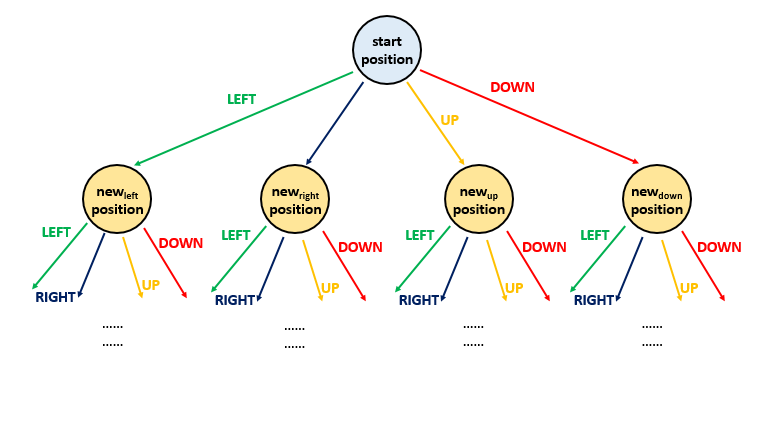
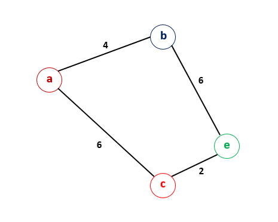
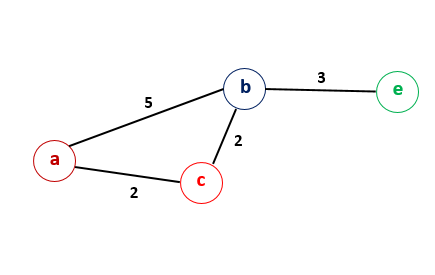

# The Maze II

## Detailed Notes on DFS, BFS, and Dijkstra-Based Approaches

## Overview

This problem asks for the **minimum number of steps** required for a ball to travel from a start position to a destination in a maze.

The ball does **not** move one cell at a time in the usual graph sense.
Instead, when it starts moving in one direction, it keeps rolling until it hits:

- a wall, or
- the maze boundary

Only then does it stop.

That changes the graph model significantly:

- each stopping position can be treated as a node
- edges correspond to rolling from one stopping position to another
- edge weights are the number of cells rolled

Because of that, this is fundamentally a **shortest path in a weighted graph** problem.

This document explains four approaches in detail:

1. **Depth-First Search (DFS)**
2. **Breadth-First Search (BFS)**
3. **Dijkstra’s Algorithm with linear min search**
4. **Dijkstra’s Algorithm with a Priority Queue**

---

# Core Graph Interpretation

A maze grid is a common way to encode a graph.

In this problem:

- each empty square is potentially a graph node
- from a current square, the ball may attempt to roll:
  - right
  - left
  - up
  - down
- the ball continues until it hits a wall or boundary
- the last valid square before the wall becomes the stopping node
- the number of cells rolled becomes the edge weight

So unlike ordinary grid shortest path problems, neighbors are **not** the immediately adjacent cells.

Instead, a neighbor is the **stopping point after a full roll**.

---

# Why Ordinary BFS Is Not the Standard Shortest-Path Tool Here

In a usual unweighted graph, BFS works because every edge has equal cost.

Here that is not true:

- one move might cost 1 step
- another move might cost 20 steps

So the graph is weighted.

That means plain BFS is not the mathematically natural shortest-path algorithm.

However, because we are repeatedly relaxing distances and re-enqueueing when improvements happen, BFS-style and DFS-style methods can still be written for this problem and accepted. They are better thought of as **graph relaxation approaches**, not classic shortest-path BFS for unweighted graphs.

The most principled algorithm is Dijkstra.

---

# Shared Idea Across All Approaches

All four approaches use the same key structure:

## Distance array

We maintain:

```text
distance[row][col]
```

which stores the minimum number of steps known so far to reach position `(row, col)` from the start.

Initially:

- all cells get `Integer.MAX_VALUE`
- the start cell gets `0`

Whenever we discover a better way to reach a stopping cell, we update the distance.

---

# How Rolling Works

From a position `(r, c)` and direction `(dr, dc)`:

1. move step by step while the next cell is inside bounds and not a wall
2. count how many steps were taken
3. stop at the last valid cell before the wall/boundary

That stopping cell becomes the next node in the shortest-path computation.

---

# Approach 1: Depth-First Search (DFS)

## Intuition

We can view the search space as a tree of possibilities:

- each node in the search tree corresponds to a stopping position in the maze
- from each stopping position, the ball may roll in up to four directions
- those four possible choices correspond to branches in the search tree

A DFS explores one branch as deeply as possible before backtracking.

In this problem, DFS works because we do **not** simply mark cells as visited once and forever.
Instead, we only continue recursion if we find a **strictly shorter distance** to a stopping position than what was known before.

So DFS here is really a recursive distance-relaxation approach.



---

## Why Distance Checking Is Essential

If we used ordinary DFS with just a visited array, it would be wrong.

A position may be discovered once by a longer route and later by a shorter route.

So we cannot freeze a node after the first visit.

That is why the `distance` array is the key structure.

We recurse only when:

```text
newDistance < oldDistance
```

This ensures that every recursive call corresponds to a real improvement.

---

## Java Code

```java
public class Solution {
    public int shortestDistance(int[][] maze, int[] start, int[] dest) {
        int[][] distance = new int[maze.length][maze[0].length];
        for (int[] row: distance)
            Arrays.fill(row, Integer.MAX_VALUE);
        distance[start[0]][start[1]] = 0;
        dfs(maze, start, distance);
        return distance[dest[0]][dest[1]] == Integer.MAX_VALUE ? -1 : distance[dest[0]][dest[1]];
    }

    public void dfs(int[][] maze, int[] start, int[][] distance) {
        int[][] dirs={{0,1}, {0,-1}, {-1,0}, {1,0}};
        for (int[] dir: dirs) {
            int x = start[0] + dir[0];
            int y = start[1] + dir[1];
            int count = 0;
            while (x >= 0 && y >= 0 && x < maze.length && y < maze[0].length && maze[x][y] == 0) {
                x += dir[0];
                y += dir[1];
                count++;
            }
            if (distance[start[0]][start[1]] + count < distance[x - dir[0]][y - dir[1]]) {
                distance[x - dir[0]][y - dir[1]] = distance[start[0]][start[1]] + count;
                dfs(maze, new int[]{x - dir[0],y - dir[1]}, distance);
            }
        }
    }
}
```

---

## Detailed Walkthrough

### 1. Initialize distance array

```java
int[][] distance = new int[maze.length][maze[0].length];
for (int[] row: distance)
    Arrays.fill(row, Integer.MAX_VALUE);
distance[start[0]][start[1]] = 0;
```

This means:

- every cell is initially unreachable
- start cell has distance 0

---

### 2. DFS from the start

```java
dfs(maze, start, distance);
```

We try all rolling possibilities recursively.

---

### 3. Direction iteration

```java
int[][] dirs={{0,1}, {0,-1}, {-1,0}, {1,0}};
```

These correspond to:

- right
- left
- up
- down

---

### 4. Roll until wall

```java
int x = start[0] + dir[0];
int y = start[1] + dir[1];
int count = 0;
while (x >= 0 && y >= 0 && x < maze.length && y < maze[0].length && maze[x][y] == 0) {
    x += dir[0];
    y += dir[1];
    count++;
}
```

This simulates the ball rolling in a straight line.

When the loop exits, `(x, y)` is one step beyond the valid stopping location, so the actual stopping point is:

```java
x - dir[0], y - dir[1]
```

---

### 5. Relax the distance

```java
if (distance[start[0]][start[1]] + count < distance[x - dir[0]][y - dir[1]]) {
    distance[x - dir[0]][y - dir[1]] = distance[start[0]][start[1]] + count;
    dfs(maze, new int[]{x - dir[0],y - dir[1]}, distance);
}
```

Only if this route improves the distance do we recurse further.

That prevents infinite useless exploration and ensures progress.

---

## Complexity Analysis

Let:

- `m` = number of rows
- `n` = number of columns

### Time Complexity

```text
O(m * n * max(m, n))
```

Why?

- in the worst case, many or all stopping positions may be processed
- from each processed position, we may roll up to 4 directions
- each roll can travel up to `max(m, n)` cells

So the accepted worst-case bound is:

```text
O(mn * max(m, n))
```

---

### Space Complexity

```text
O(mn)
```

Why?

- the `distance` array uses `O(mn)`
- recursive DFS can also use stack depth, but the dominant explicit structure here is the distance table

---

## Strengths and Weaknesses

### Strengths

- conceptually simple once relaxation is understood
- easy recursive implementation

### Weaknesses

- not the most natural shortest-path algorithm for weighted graphs
- recursion may revisit cells multiple times as distances improve
- recursion depth can be a concern

---

# Approach 2: Breadth-First Search (BFS)

## Intuition

This approach is similar to the DFS method, except that instead of exploring deeply via recursion, we use a queue and explore positions in a broader order.

Again, this is **not** plain shortest-path BFS on an unweighted graph.

It works because:

- we maintain a distance array
- whenever we find a better distance to a stopping position, we push it into the queue again

So the queue acts as a worklist of positions whose improved distances may help relax others.

---

## Java Code

```java
public class Solution {
    public int shortestDistance(int[][] maze, int[] start, int[] dest) {
        int[][] distance = new int[maze.length][maze[0].length];
        for (int[] row: distance)
            Arrays.fill(row, Integer.MAX_VALUE);
        distance[start[0]][start[1]] = 0;
        int[][] dirs={{0, 1} ,{0, -1}, {-1, 0}, {1, 0}};
        Queue<int[]> queue = new LinkedList<>();
        queue.add(start);
        while (!queue.isEmpty()) {
            int[] s = queue.remove();
            for (int[] dir: dirs) {
                int x = s[0] + dir[0];
                int y = s[1] + dir[1];
                int count = 0;
                while (x >= 0 && y >= 0 && x < maze.length && y < maze[0].length && maze[x][y] == 0) {
                    x += dir[0];
                    y += dir[1];
                    count++;
                }
                if (distance[s[0]][s[1]] + count < distance[x - dir[0]][y - dir[1]]) {
                    distance[x - dir[0]][y - dir[1]] = distance[s[0]][s[1]] + count;
                    queue.add(new int[] {x - dir[0], y - dir[1]});
                }
            }
        }
        return distance[dest[0]][dest[1]] == Integer.MAX_VALUE ? -1 : distance[dest[0]][dest[1]];
    }
}
```

---

## How It Differs from DFS

The core relaxation logic is identical:

- roll in each direction
- compute stopping position and step count
- update distance if improved

The only difference is the frontier management:

- DFS uses recursion
- BFS uses an explicit queue

---

## Why It Still Works

Whenever a position’s shortest known distance improves, that position is put back into the queue.

This means the algorithm keeps propagating improvements until no further relaxation is possible.

This is similar in spirit to repeated relaxation methods.

---

## Complexity Analysis

### Time Complexity

```text
O(m * n * max(m, n))
```

Same general reasoning as DFS:

- potentially many stopping positions
- each expansion rolls across rows or columns

### Space Complexity

```text
O(mn)
```

Why?

- `distance` array uses `O(mn)`
- queue can also grow to `O(mn)` in the worst case

---

## Strengths and Weaknesses

### Strengths

- iterative
- avoids recursion depth issues
- same relaxation idea as DFS

### Weaknesses

- still not as principled as Dijkstra for weighted shortest paths
- a queue does not inherently prioritize smaller-distance states

This leads us to Dijkstra.

---

# Approach 3: Dijkstra’s Algorithm with Linear Minimum Search

## Intuition

This is the first fully principled weighted shortest-path solution.

Dijkstra’s algorithm works on graphs with nonnegative edge weights.

The methodology here is:

- keep a distance array
- repeatedly select the unvisited node with the smallest tentative distance
- relax all neighbors from that node
- mark it visited
- never revisit it as the current node again

This is exactly Dijkstra’s algorithm.





---

## Why It Is Correct

In graphs with nonnegative edge weights, once Dijkstra selects the currently smallest-distance unvisited node, that node’s shortest path is finalized.

Since rolling distances are always nonnegative, Dijkstra applies perfectly.

---

## Java Code

```java
public class Solution {
    public int shortestDistance(int[][] maze, int[] start, int[] dest) {
        int[][] distance = new int[maze.length][maze[0].length];
        boolean[][] visited = new boolean[maze.length][maze[0].length];
        for (int[] row: distance)
            Arrays.fill(row, Integer.MAX_VALUE);
        distance[start[0]][start[1]] = 0;
        dijkstra(maze, distance, visited);
        return distance[dest[0]][dest[1]] == Integer.MAX_VALUE ? -1 : distance[dest[0]][dest[1]];
    }

    public int[] minDistance(int[][] distance, boolean[][] visited) {
        int[] min={-1,-1};
        int min_val = Integer.MAX_VALUE;
        for (int i = 0; i < distance.length; i++) {
            for (int j = 0; j < distance[0].length; j++) {
                if (!visited[i][j] && distance[i][j] < min_val) {
                    min = new int[] {i, j};
                    min_val = distance[i][j];
                }
            }
        }
        return min;
    }

    public void dijkstra(int[][] maze, int[][] distance, boolean[][] visited) {
        int[][] dirs={{0,1},{0,-1},{-1,0},{1,0}};
        while (true) {
            int[] s = minDistance(distance, visited);
            if (s[0] < 0)
                break;
            visited[s[0]][s[1]] = true;
            for (int[] dir: dirs) {
                int x = s[0] + dir[0];
                int y = s[1] + dir[1];
                int count = 0;
                while (x >= 0 && y >= 0 && x < maze.length && y < maze[0].length && maze[x][y] == 0) {
                    x += dir[0];
                    y += dir[1];
                    count++;
                }
                if (distance[s[0]][s[1]] + count < distance[x - dir[0]][y - dir[1]]) {
                    distance[x - dir[0]][y - dir[1]] = distance[s[0]][s[1]] + count;
                }
            }
        }
    }
}
```

---

## Detailed Walkthrough

### 1. Distance and visited arrays

```java
int[][] distance = new int[maze.length][maze[0].length];
boolean[][] visited = new boolean[maze.length][maze[0].length];
```

- `distance` stores the best known distance
- `visited` marks cells whose shortest distance is finalized

---

### 2. Find next current node

```java
public int[] minDistance(int[][] distance, boolean[][] visited)
```

This helper scans the entire grid to find the unvisited cell with smallest tentative distance.

That is correct but expensive.

---

### 3. Relax neighbors

For the selected current node:

- roll in each direction
- compute stopping cell and rolled distance
- update tentative distance if shorter

This is the standard Dijkstra relaxation step.

---

## Complexity Analysis

### Time Complexity

```text
O((mn)^2)
```

Why?

The expensive part is:

```java
minDistance(...)
```

which scans all `m * n` cells every time we need the next node.

If this happens for many cells, total complexity becomes quadratic in the number of cells.

---

### Space Complexity

```text
O(mn)
```

for the `distance` and `visited` arrays.

---

## Strengths and Weaknesses

### Strengths

- clean Dijkstra logic
- mathematically principled

### Weaknesses

- inefficient current-node selection
- scanning the whole board each time is too costly

This motivates the priority-queue optimization.

---

# Approach 4: Dijkstra’s Algorithm with Priority Queue

## Intuition

The previous Dijkstra approach was slowed down by the `minDistance(...)` scan.

We can replace that with a **priority queue (min-heap)**.

The heap always keeps the smallest-distance candidate on top.

That means:

- extracting the next current node becomes efficient
- we no longer scan the whole grid each time

This is the standard optimized Dijkstra implementation.

---

## Java Code

```java
public class Solution {
    public int shortestDistance(int[][] maze, int[] start, int[] dest) {
        int[][] distance = new int[maze.length][maze[0].length];
        for (int[] row: distance)
            Arrays.fill(row, Integer.MAX_VALUE);
        distance[start[0]][start[1]] = 0;
        dijkstra(maze, start, distance);
        return distance[dest[0]][dest[1]] == Integer.MAX_VALUE ? -1 : distance[dest[0]][dest[1]];
    }

    public void dijkstra(int[][] maze, int[] start, int[][] distance) {
        int[][] dirs={{0,1},{0,-1},{-1,0},{1,0}};
        PriorityQueue<int[]> queue = new PriorityQueue<>((a, b) -> a[2] - b[2]);
        queue.offer(new int[]{start[0],start[1],0});
        while (!queue.isEmpty()) {
            int[] s = queue.poll();
            if(distance[s[0]][s[1]] < s[2])
                continue;
            for (int[] dir: dirs) {
                int x = s[0] + dir[0];
                int y = s[1] + dir[1];
                int count = 0;
                while (x >= 0 && y >= 0 && x < maze.length && y < maze[0].length && maze[x][y] == 0) {
                    x += dir[0];
                    y += dir[1];
                    count++;
                }
                if (distance[s[0]][s[1]] + count < distance[x - dir[0]][y - dir[1]]) {
                    distance[x - dir[0]][y - dir[1]] = distance[s[0]][s[1]] + count;
                    queue.offer(new int[]{x - dir[0], y - dir[1], distance[x - dir[0]][y - dir[1]]});
                }
            }
        }
    }
}
```

---

## Detailed Walkthrough

### 1. Priority Queue Entries

Each heap entry stores:

```java
[row, col, currentDistance]
```

The comparator:

```java
(a, b) -> a[2] - b[2]
```

ensures the smallest-distance entry is popped first.

---

### 2. Lazy Deletion

```java
if(distance[s[0]][s[1]] < s[2])
    continue;
```

A node may appear multiple times in the heap because its distance may improve after an earlier worse entry was already inserted.

So when we pop an entry:

- if it is stale, ignore it
- otherwise process it

This is a standard Dijkstra implementation pattern.

---

### 3. Relax neighbors

Same rolling logic as before:

- try all four directions
- roll until wall
- compute stopping point and rolled count
- relax distance

If improved, push the new state into the heap.

---

## Why This Is Better Than the Previous Dijkstra

Instead of scanning all cells to find the next minimum-distance node, the heap maintains that ordering incrementally.

That reduces the expensive selection step.

---

## Complexity Analysis

### Time Complexity

```text
O(mn * log(mn))
```

Why?

- in the worst case, many positions may be inserted and extracted
- each heap operation costs `O(log(mn))`
- across the maze, this yields the accepted complexity

### Space Complexity

```text
O(mn)
```

Why?

- `distance` array uses `O(mn)`
- heap may hold up to `O(mn)` entries in the worst case

---

# Comparing the Four Approaches

## Approach 1: DFS

### Idea

Recursive relaxation from positions whose distance improves.

### Time

```text
O(mn * max(m, n))
```

### Space

```text
O(mn)
```

### Good For

Simple recursive exploration idea.

---

## Approach 2: BFS

### Idea

Queue-based repeated relaxation.

### Time

```text
O(mn * max(m, n))
```

### Space

```text
O(mn)
```

### Good For

Iterative relaxation without recursion.

---

## Approach 3: Dijkstra with linear min search

### Idea

Weighted shortest path, but selecting next node by scanning all cells.

### Time

```text
O((mn)^2)
```

### Space

```text
O(mn)
```

### Good For

Understanding the raw Dijkstra framework.

---

## Approach 4: Dijkstra with priority queue

### Idea

Optimized Dijkstra using a heap.

### Time

```text
O(mn * log(mn))
```

### Space

```text
O(mn)
```

### Good For

Best practical and standard solution.

---

# Which Approach Should You Prefer?

Use **Approach 4: Dijkstra with Priority Queue**.

It is the most principled and efficient standard solution because:

- the graph edges are weighted
- Dijkstra is the right shortest-path algorithm
- the heap removes the expensive linear scan from Approach 3

DFS and BFS approaches can still be useful for understanding relaxation behavior, but Dijkstra is the strongest final answer.

---

# Final Takeaway

The heart of the problem is recognizing that this maze is **not an ordinary unweighted grid graph**.

The ball rolls until it hits a wall, so each move has a variable cost.

That makes the problem a **weighted shortest path** problem.

Once that is recognized:

- Dijkstra is the natural algorithm
- a priority queue gives the optimized implementation

---

# Summary

## Problem

Find the minimum number of steps needed for a rolling ball to stop at the destination in a maze.

## Key Insight

The maze is a weighted graph:

- nodes = stopping positions
- edges = full rolls
- edge weight = number of cells rolled

## Approaches

### 1. DFS

- recursive relaxation
- **Time:** `O(mn * max(m, n))`
- **Space:** `O(mn)`

### 2. BFS

- queue-based relaxation
- **Time:** `O(mn * max(m, n))`
- **Space:** `O(mn)`

### 3. Dijkstra with linear scan

- principled weighted shortest path
- expensive node selection
- **Time:** `O((mn)^2)`
- **Space:** `O(mn)`

### 4. Dijkstra with priority queue

- optimized shortest path solution
- **Time:** `O(mn * log(mn))`
- **Space:** `O(mn)`

## Recommended

Use **Dijkstra with a Priority Queue** as the standard and most efficient solution.
