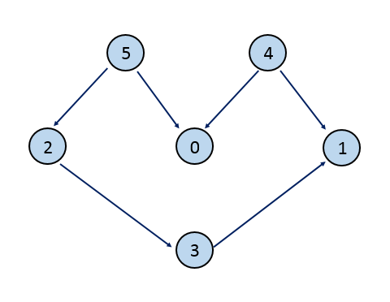

## Detailed Notes on the Topological Sort Approach

## Overview

This design problem asks us to build a simplified spreadsheet system similar to Excel.

A cell can store either:

- a direct integer value, or
- a formula that depends on other cells

The challenge is that when one cell changes, every cell that depends on it — directly or indirectly — may also need to be recomputed.

That makes this a **dependency propagation** problem.

The editorial approach models those dependencies as a **directed acyclic graph (DAG)** and uses **topological sorting** to update cells in a correct order.

---

# Core Intuition

Suppose we have:

```text
C1 = C2 + C3
```

If either `C2` or `C3` changes, then `C1` must be recomputed.

Now suppose:

```text
D2 = C1 + A1
```

Then if `C2` changes:

- first `C1` must be updated
- then `D2` must be updated

So updates must flow along the dependency chain in the correct order.

That means we need a way to process affected cells such that:

> any cell is recomputed only after all cells it depends on have already been recomputed

That is exactly the kind of ordering problem solved by **topological sort** on a **DAG**.



---

# Why This Forms a Directed Graph

We can represent dependencies as a directed graph:

- each cell is a node
- if cell `A` is used in the formula of cell `B`, then `B` depends on `A`

A useful directed edge interpretation is:

```text
A -> B
```

meaning:

```text
A must be evaluated before B
```

Because the problem assumes there are no cycles in formulas, this graph is a **Directed Acyclic Graph**.

That is what makes topological sort possible.

---

# Why Topological Sort Is Needed

When a value changes, we must recompute all dependent cells.

But the order matters.

For example, if:

```text
A1 = 5
B1 = A1 + 2
C1 = B1 + 3
```

and `A1` changes, then:

1. recompute `B1`
2. then recompute `C1`

If we did it in reverse, `C1` would read an outdated value of `B1`.

So we need a valid order where dependencies come first.

That is exactly what topological sorting guarantees.

---

# Refresher: Topological Sort

A topological ordering of a DAG is a linear ordering of its nodes such that:

- for every directed edge `u -> v`
- `u` appears before `v`

In this problem, that means:

- cells that are depended on come earlier
- dependent cells come later

One standard way to build a topological ordering is via DFS plus a stack:

1. recursively visit dependent nodes
2. push current node onto stack only after all downstream nodes are handled
3. later pop from the stack to get the correct evaluation order

---

# Data Structure Design

The editorial uses a helper structure called `Formula`.

Each cell stores:

1. `val` — the current numeric value of the cell
2. `cells` — a frequency map describing which cells the current cell depends on

---

## Why the dependency map stores counts

A formula can mention the same cell multiple times.

Example:

```text
C1 = C2 + C3 + C2
```

Here:

- `C2` appears twice
- `C3` appears once

So the dependency map must store:

```text
C2 -> 2
C3 -> 1
```

This is why the map is:

```text
HashMap<String, Integer>
```

instead of just a set.

---

# Meaning of the `Formula` Class

```java
class Formula {
    HashMap<String, Integer> cells;
    int val;
}
```

- `cells` stores the formula dependencies
- `val` stores the evaluated numeric result of that cell

If `cells` is empty, the cell behaves like a directly assigned constant value.

---

# Spreadsheet Storage

The spreadsheet is stored as:

```java
Formula[][] Formulas;
```

So each position in the grid holds either:

- `null` if never initialized, or
- a `Formula` object

Rows are 1-indexed in the API, but the array internally uses 0-based indexing.

Columns are given as letters (`A`, `B`, `C`, ...), so they are converted by:

```java
c - 'A'
```

---

# Main Methods to Implement

The design requires these major operations:

1. `Excel(int H, char W)`
2. `get(int row, char column)`
3. `set(int row, char column, int val)`
4. `sum(int row, char column, String[] strs)`

We will now go through each one in detail.

---

# 1. Constructor

## Goal

Initialize the spreadsheet storage.

## Code

```java
public Excel(int H, char W) {
    Formulas = new Formula[H][(W - 'A') + 1];
}
```

## Explanation

If the last column is `W`, then the total number of columns is:

```text
(W - 'A') + 1
```

So the spreadsheet becomes a `H x columns` array.

---

# 2. `get(row, column)`

## Goal

Return the current numeric value stored at the specified cell.

## Code

```java
public int get(int r, char c) {
    if (Formulas[r - 1][c - 'A'] == null)
        return 0;
    return Formulas[r - 1][c - 'A'].val;
}
```

## Explanation

If the cell has never been initialized, return `0`.

Otherwise return the current stored value.

This is straightforward because every formula cell always stores its latest evaluated result in `val`.

---

# 3. `set(row, column, val)`

## Goal

Assign a direct numeric value to a cell.

This also means:

- any previous formula on that cell must be removed
- all dependent cells must be recomputed

---

## Why previous formulas must be removed

A cell cannot simultaneously mean both:

```text
A1 = 10
```

and

```text
A1 = B1 + C1
```

So when `set(...)` is called, the old dependency structure of that cell must be discarded.

That is done by replacing the cell with a new `Formula` object whose dependency map is empty.

---

## Code

```java
public void set(int r, char c, int v) {
    Formulas[r - 1][c - 'A'] = new Formula(new HashMap<String, Integer>(), v);
    topologicalSort(r - 1, c - 'A');
    execute_stack();
}
```

---

## Explanation

### Step 1: overwrite the current cell

```java
Formulas[r - 1][c - 'A'] = new Formula(new HashMap<String, Integer>(), v);
```

This makes the cell a plain constant-valued cell with no dependencies.

### Step 2: find all dependent cells in topological order

```java
topologicalSort(...)
```

### Step 3: recompute those cells in the right order

```java
execute_stack()
```

So `set(...)` updates both the changed cell and everything downstream.

---

# 4. `sum(row, column, strs)`

## Goal

Create a formula for the target cell based on a list of cell references and/or ranges, then return its computed value.

Example inputs might include:

```text
["A1", "B2:C3", "D4"]
```

---

## Main tasks in `sum(...)`

1. Expand all listed cells and ranges into a frequency map
2. Compute the new value for the formula
3. Store the dependency map on the target cell
4. Propagate updates to dependent cells

---

## Code

```java
public int sum(int r, char c, String[] strs) {
    HashMap<String, Integer> cells = convert(strs);
    int summ = calculate_sum(r - 1, c - 'A', cells);
    set(r, c, summ);
    Formulas[r - 1][c - 'A'] = new Formula(cells, summ);
    return summ;
}
```

---

## Explanation

### Step 1: expand the formula references

```java
HashMap<String, Integer> cells = convert(strs);
```

This builds the dependency map with frequencies.

### Step 2: compute the sum using current spreadsheet values

```java
int summ = calculate_sum(...)
```

### Step 3: use `set(...)` to update downstream cells

```java
set(r, c, summ);
```

This ensures dependent cells are recomputed.

### Step 4: restore the formula metadata for this cell

```java
Formulas[r - 1][c - 'A'] = new Formula(cells, summ);
```

Because `set(...)` replaced the cell with a constant-style formula, we now restore the true dependency map.

### Step 5: return the computed value

```java
return summ;
```

---

# Expanding Ranges: `convert(...)`

## Goal

Turn formula inputs like:

```text
["A1", "A1:B2", "C3"]
```

into a frequency map.

---

## Code

```java
public HashMap<String, Integer> convert(String[] strs) {
    HashMap<String, Integer> res = new HashMap<>();
    for (String st: strs) {
        if (st.indexOf(":") < 0)
            res.put(st, res.getOrDefault(st, 0) + 1);
        else {
            String[] cells = st.split(":");
            int si = Integer.parseInt(cells[0].substring(1)), ei = Integer.parseInt(cells[1].substring(1));
            char sj = cells[0].charAt(0), ej = cells[1].charAt(0);
            for (int i = si; i <= ei; i++) {
                for (char j = sj; j <= ej; j++) {
                    res.put("" + j + i, res.getOrDefault("" + j + i, 0) + 1);
                }
            }
        }
    }
    return res;
}
```

---

## Explanation

### Single-cell reference

If the string contains no `:`:

```text
"A1"
```

then simply add that cell to the map.

### Range reference

If the string contains `:`:

```text
"A1:C3"
```

then:

- parse the start and end rows
- parse the start and end columns
- iterate over the full rectangle
- add each cell into the map

If a cell appears multiple times across the input formula, its frequency increases accordingly.

---

# Computing a Formula Value: `calculate_sum(...)`

## Goal

Given a dependency map for a cell, compute the total value implied by the current spreadsheet state.

---

## Code

```java
public int calculate_sum(int r, int c, HashMap<String, Integer> cells) {
    int sum = 0;
    for (String s: cells.keySet()) {
        int x = Integer.parseInt(s.substring(1)) - 1, y = s.charAt(0) - 'A';
        sum += (Formulas[x][y] != null ? Formulas[x][y].val : 0) * cells.get(s);
    }
    Formulas[r][c] = new Formula(cells, sum);
    return sum;
}
```

---

## Explanation

For each referenced cell:

1. decode its row/column
2. fetch its current value
3. multiply by its frequency
4. add to the running total

If a referenced cell has never been initialized, it contributes `0`.

Finally, the target cell is updated with:

- its dependency map
- its computed value

---

# Dependency Propagation with Topological Sort

Now we reach the central design idea.

When a cell changes, we must update every cell that depends on it, directly or indirectly.

But the order matters.

The editorial solves this by:

1. finding dependent cells through recursive traversal
2. pushing them onto a stack in topological order
3. evaluating them by popping the stack

---

## `topologicalSort(r, c)`

### Goal

Find all cells that depend on cell `(r, c)` and push them onto the stack so they can later be recomputed in a valid order.

---

## Code

```java
public void topologicalSort(int r, int c) {
    for (int i = 0; i < Formulas.length; i++)
        for (int j = 0; j < Formulas[0].length; j++)
            if (Formulas[i][j] != null && Formulas[i][j].cells.containsKey("" + (char)('A' + c) + (r + 1))) {
                topologicalSort(i, j);
            }
    stack.push(new int[] {r,c});
}
```

---

## Explanation

The editorial’s graph is not stored as an explicit forward dependency graph.

Instead, to find cells that depend on `(r, c)`, it scans the entire spreadsheet and checks:

- does any cell’s dependency map mention the current cell?

If yes, that cell depends on the current one, so recursively topologically sort it first.

After all downstream dependents are processed, push the current cell onto the stack.

This guarantees that when the stack is later popped, cells are evaluated in dependency-safe order.

---

# Re-evaluating the Stack: `execute_stack()`

## Goal

Pop cells from the stack and recompute any formula cells.

---

## Code

```java
public void execute_stack() {
    while (!stack.isEmpty()) {
        int[] top = stack.pop();
        if (Formulas[top[0]][top[1]].cells.size() > 0)
            calculate_sum(top[0], top[1], Formulas[top[0]][top[1]].cells);
    }
}
```

---

## Explanation

When a cell is popped:

- if its dependency map is nonempty, it is a formula cell
- recompute it based on the most recently updated dependencies

This is exactly why topological ordering matters.

By the time a formula cell is evaluated, every cell it depends on has already been updated.

---

# Full Editorial Code

```java
public class Excel {
    Formula[][] Formulas;

    class Formula {
        Formula(HashMap<String, Integer> c, int v) {
            val = v;
            cells = c;
        }
        HashMap<String, Integer> cells;
        int val;
    }

    Stack<int[]> stack = new Stack<>();

    public Excel(int H, char W) {
        Formulas = new Formula[H][(W - 'A') + 1];
    }

    public int get(int r, char c) {
        if (Formulas[r - 1][c - 'A'] == null)
            return 0;
        return Formulas[r - 1][c - 'A'].val;
    }

    public void set(int r, char c, int v) {
        Formulas[r - 1][c - 'A'] = new Formula(new HashMap<String, Integer>(), v);
        topologicalSort(r - 1, c - 'A');
        execute_stack();
    }

    public int sum(int r, char c, String[] strs) {
        HashMap<String, Integer> cells = convert(strs);
        int summ = calculate_sum(r - 1, c - 'A', cells);
        set(r, c, summ);
        Formulas[r - 1][c - 'A'] = new Formula(cells, summ);
        return summ;
    }

    public void topologicalSort(int r, int c) {
        for (int i = 0; i < Formulas.length; i++)
            for (int j = 0; j < Formulas[0].length; j++)
                if (Formulas[i][j] != null && Formulas[i][j].cells.containsKey("" + (char)('A' + c) + (r + 1))) {
                    topologicalSort(i, j);
                }
        stack.push(new int[] {r,c});
    }

    public void execute_stack() {
        while (!stack.isEmpty()) {
            int[] top = stack.pop();
            if (Formulas[top[0]][top[1]].cells.size() > 0)
                calculate_sum(top[0], top[1], Formulas[top[0]][top[1]].cells);
        }
    }

    public HashMap<String, Integer> convert(String[] strs) {
        HashMap<String, Integer> res = new HashMap<>();
        for (String st: strs) {
            if (st.indexOf(":") < 0)
                res.put(st, res.getOrDefault(st, 0) + 1);
            else {
                String[] cells = st.split(":");
                int si = Integer.parseInt(cells[0].substring(1)), ei = Integer.parseInt(cells[1].substring(1));
                char sj = cells[0].charAt(0), ej = cells[1].charAt(0);
                for (int i = si; i <= ei; i++) {
                    for (char j = sj; j <= ej; j++) {
                        res.put("" + j + i, res.getOrDefault("" + j + i, 0) + 1);
                    }
                }
            }
        }
        return res;
    }

    public int calculate_sum(int r, int c, HashMap<String, Integer> cells) {
        int sum = 0;
        for (String s: cells.keySet()) {
            int x = Integer.parseInt(s.substring(1)) - 1, y = s.charAt(0) - 'A';
            sum += (Formulas[x][y] != null ? Formulas[x][y].val : 0) * cells.get(s);
        }
        Formulas[r][c] = new Formula(cells, sum);
        return sum;
    }
}
```

---

# Performance Analysis

Let:

- `r` = number of rows
- `c` = number of columns
- `l` = number of strings passed into the `sum(...)` formula call

---

## `get(...)`

### Time Complexity

```text
O(1)
```

Only a direct lookup is performed.

---

## `set(...)`

### Time Complexity

```text
O((r * c)^2)
```

### Why?

In the worst case:

- there can be `O(r * c)` cells
- to find cells dependent on one current cell, `topologicalSort` scans the entire sheet
- this may happen across many formula cells

So worst-case dependency propagation becomes quadratic in the number of cells.

---

## `sum(...)`

### Time Complexity

```text
O((r * c)^2 + 2 * r * c * l)
```

### Why?

There are three major parts:

#### 1. Expanding ranges with `convert(...)`

Each of the `l` strings may expand to as many as `O(r * c)` cells.

So this can take:

```text
O(l * r * c)
```

#### 2. Calculating the sum

`calculate_sum(...)` traverses the expanded dependency map.

Again this can cost:

```text
O(l * r * c)
```

#### 3. Propagating updates to dependent cells

This is essentially the same work as `set(...)`, which in the worst case is:

```text
O((r * c)^2)
```

Combining them gives:

```text
O((r * c)^2 + 2 * r * c * l)
```

---

## Space Complexity

### Worst Case

```text
O((r * c)^2)
```

### Why?

- the spreadsheet itself has `O(r * c)` cells
- each cell’s dependency map may, in the worst case, reference `O(r * c)` cells

So total storage can reach quadratic in the number of cells.

---

# Strengths of This Approach

- conceptually clean once dependency graph is recognized
- correct evaluation order is guaranteed by topological sorting
- supports both direct values and formulas
- handles repeated cell references correctly using frequencies

---

# Weaknesses of This Approach

- dependency discovery is expensive because `topologicalSort` scans the whole sheet to find dependents
- not optimized for very large spreadsheets
- stores formulas in a way that makes recomputation possible, but not maximally efficient

A more optimized design would usually maintain an explicit reverse dependency graph, so dependent cells can be found directly instead of scanning the whole grid.

---

# Final Takeaway

The heart of the problem is:

> changing one cell can trigger a chain of updates across many dependent cells

That turns the spreadsheet into a dependency DAG.

To recompute values correctly, we must evaluate cells in an order where prerequisites come first.

That is exactly what topological sorting provides.

So the editorial approach is:

1. store formulas as dependency maps
2. when a cell changes, find all dependent cells
3. topologically order them
4. recompute them from the bottom up

---

# Summary

## Main Idea

Treat spreadsheet formulas as a dependency graph and use topological sorting to recompute cells in the correct order after updates.

## Core Structures

- `Formula.val` = current cell value
- `Formula.cells` = dependency frequency map

## Main Operations

- `get(...)` → return current value
- `set(...)` → overwrite with direct value and recompute dependents
- `sum(...)` → build dependency map, compute formula, and recompute dependents

## Key Helper Methods

- `convert(...)` → expand ranges into cell-frequency map
- `calculate_sum(...)` → compute a formula cell’s value
- `topologicalSort(...)` → find evaluation order
- `execute_stack(...)` → recompute cells in that order

## Complexities

- **get:** `O(1)`
- **set:** `O((r * c)^2)`
- **sum:** `O((r * c)^2 + 2 * r * c * l)`
- **space:** `O((r * c)^2)`

## Recommended Understanding

This is best seen as a **dependency propagation problem on a DAG**, solved with **topological sorting**.
